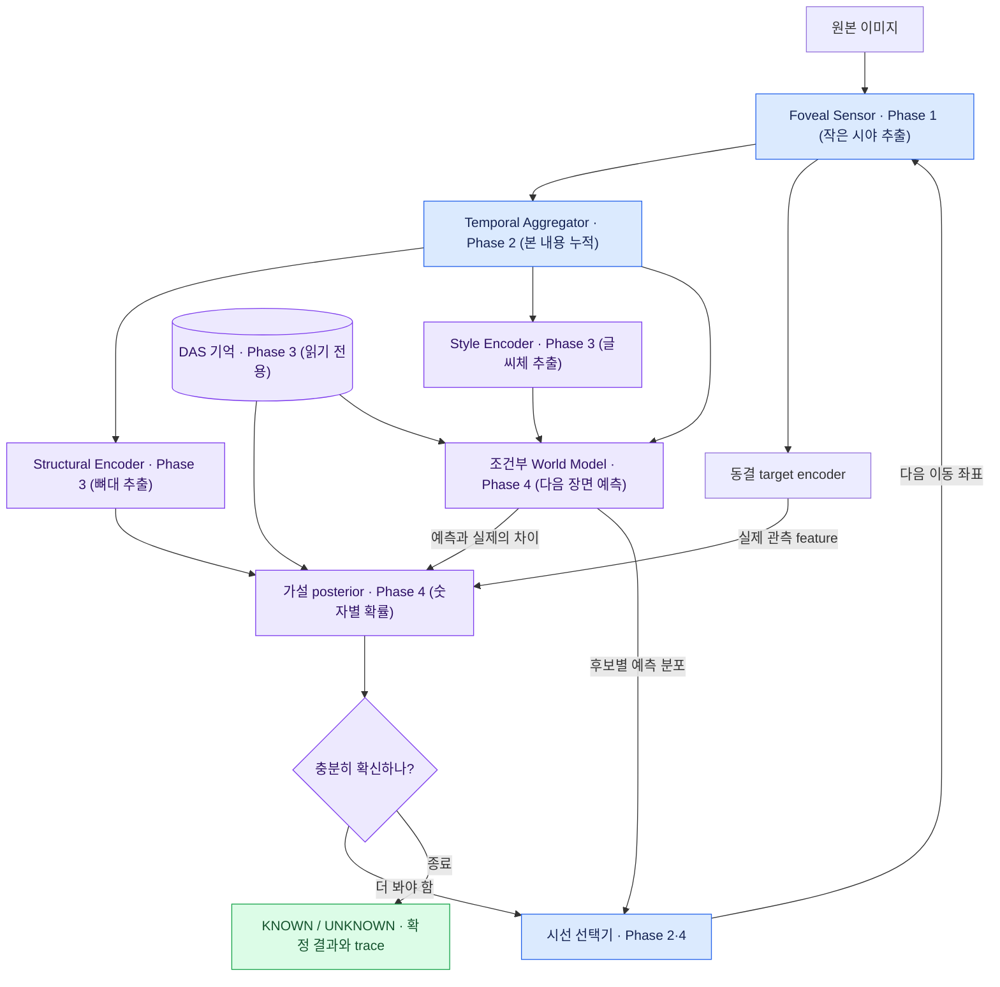
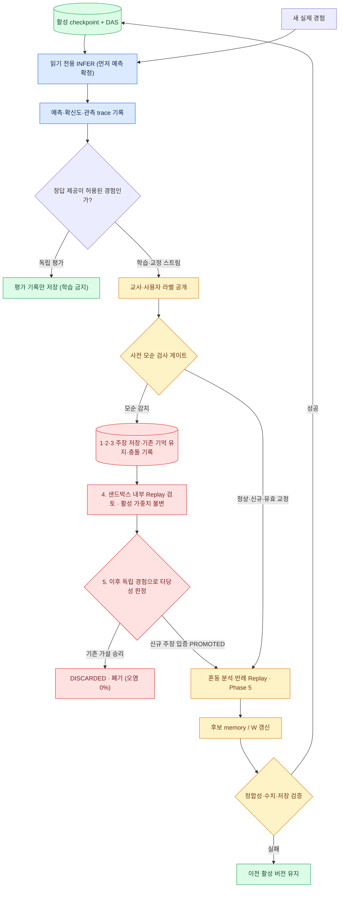
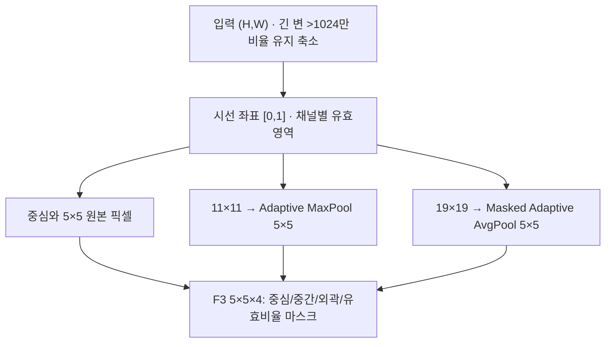
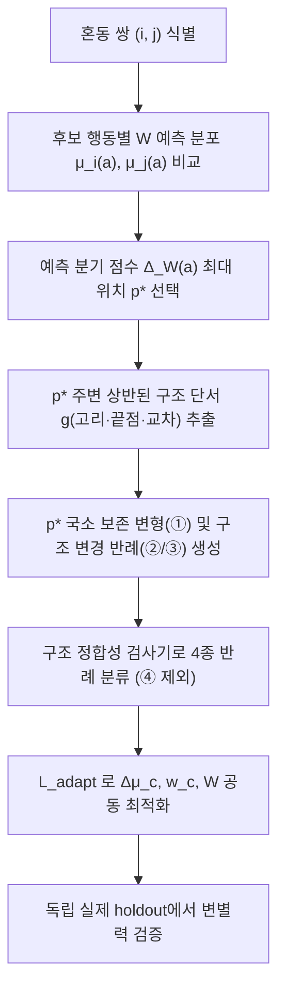
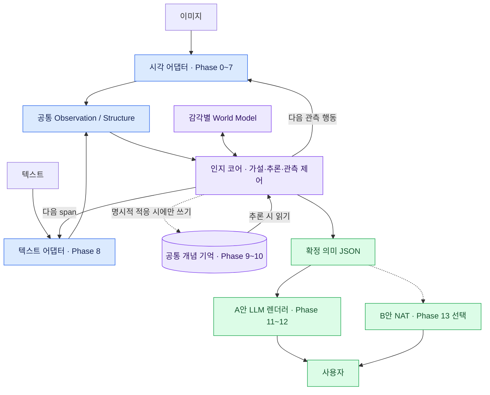
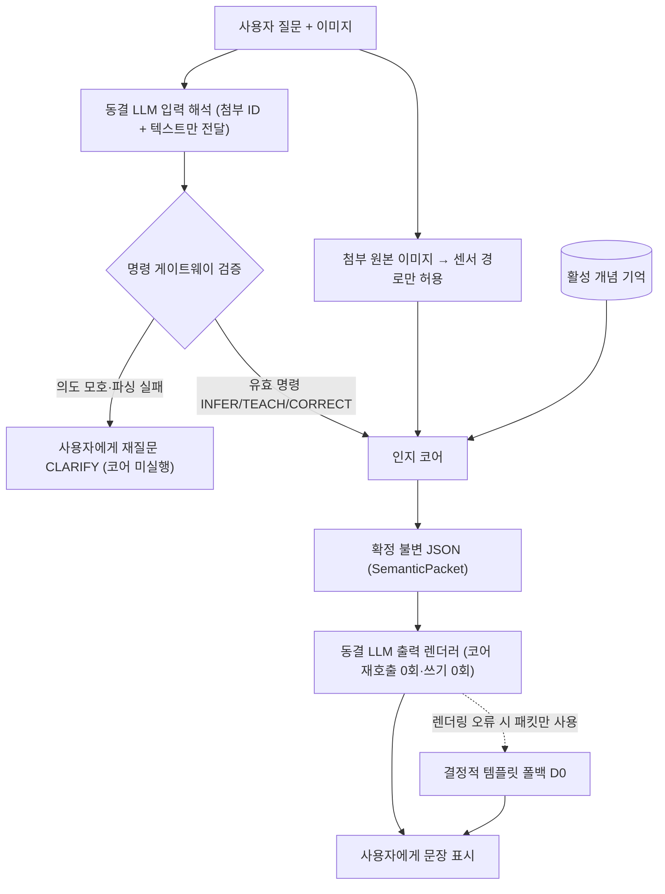

# FoveaCore 연구·구현 계획서 v1.9.3 (GPU 기준 개정본)

> 사람 눈처럼 좁은 시야를 옮겨 가며 사물을 관찰하고, 단 1장의 예시에서 핵심 뼈대를 배운 뒤, "내 예상이 맞는지" 스스로 확인하며 틀린 부분을 복습하고 모순된 교정은 가설로 격리·검토한 뒤 독립 경험으로 심판하는 초경량 인지 엔진

- **프로젝트·패키지:** FoveaCore (`foveacore`)
- **기본 프로젝트 (Phase 0~7):** 텍스트나 LLM 없이 독립 실행되는 **초경량 시각 인지 엔진**
- **확장 프로젝트 (Phase 8~12):** 이미지·텍스트 공통 개념 인지 및 단방향 **로컬 LLM 인터페이스**
- **선택 연구 (Phase 13):** 단어를 순차 생성하지 않고 문장 전체를 병렬 출력하는 **비자기회귀 언어 출력기(NAT B안)**
- **최초 숫자 경험:** MNIST 클래스당 1장, 총 10장(추가 실제 숫자 경험은 지속 학습 실험에서만 허용, P3 참고군 제외)
- **문서 성격:** 최종 구현 명세 및 사전 등록용 검증 계획(수치는 초기 설정 또는 연구 목표치이며 실측 결과가 아님)

---

## 한눈에 보는 핵심 용어 사전 (직관 설명)

| 용어 | 쉽게 풀면 무슨 뜻인가? | 구체적 예시 |
|---|---|---|
| **중심와 능동 시각**<br>(Foveal Active Vision) | 이미지 전체를 한 번에 보지 않고, 사람 눈처럼 **작은 창(중심와)으로 한 군데만 선명하게 보고 주변은 흐릿하게 보면서, "다음엔 어디를 볼까?" 스스로 시선을 옮기는 방식** | 캄캄한 방에서 손전등으로 숫자 획을 따라 첫 관측부터 바로 판정하거나, 필요하면 10번 이상도 비춰 보고 무슨 숫자인지 맞히기 |
| **구조·스타일 분리 & DAS**<br>(1-Shot 구조 기억) | 사물의 **핵심 뼈대(구조)**와 **겉모습(스타일)**을 떼어 내어, 단 1장만 보고도 뼈대만 깔끔하게 기억해 두는 장치 | 숫자 '3'의 뼈대(위아래 열린 곡선 2개)와 글씨체(기울기·굵기)를 분리해 기억해, 다른 사람이 쓴 '3'도 알아보기 |
| **조건부 World Model**<br>(내부 시뮬레이터) | *"내가 지금 보는 게 만약 숫자 A라면, 저쪽을 봤을 때 이런 모양이 나올 거야"* 하고 **다음 장면을 머릿속으로 미리 그려 보는 예측기** | 위쪽 고리를 보고 '3' 또는 '8'이라 짐작한 뒤, 왼쪽 중간에 획이 이어질지 예측하기 |
| **가설 기반 역추론**<br>(Inverse Abductive Inference) | 몇 번 관찰해 세운 가설(예: 3 vs 8)을 바탕으로 **"가설을 가장 잘 갈라줄 위치"**를 쳐다보고, 내 예측과 실제가 다르면 **가설 확률을 고쳐 나가는 과정** | 8이라고 예상하고 왼쪽 중간을 봤는데 비어 있으면, 즉시 8 확률을 깎고 3을 선택하기 |
| **반례 Replay**<br>(Counterfactual Replay) | 이미지를 무작정 돌리고 키우는 일반 증강이 아니라, 모델이 실제로 **헷갈려 하는 두 개념의 결정적 차이만 콕 집어 가상 사례를 만들고 복습**하는 학습법 | '3'과 '8'이 헷갈릴 때, 고리가 닫히는지 열리는지 경계 사례를 집중 생성·복습하기 |
| **Test-Then-Train**<br>(실시간 지속 학습) | 모델이 먼저 자기 힘으로 답을 말한 뒤(Test), 사람이 진짜 정답을 알려주면 그 경험을 받아들여 스스로 복습·성장하는(Train) 순환 구조 | 추론(11? 모름) → 교사 정답("11이야") → 내부 복습 → 다음 독립 11 이미지 인식 |
| **능동 가설 격리 & 샌드박스 Replay**<br>(Quarantine & Verification) | 기존 기억과 충돌하는 교정이 들어오면 **기존 기억은 지킨 채 `주장·충돌`을 외부(`quarantine.json`)에 따로 저장하고, 활성 가중치를 건드리지 않는 샌드박스 Replay로 두 가설의 차이를 검토한 뒤, 이후 독립 경험으로 어느 가설이 맞는지 최종 판정**하는 방어 체계 | '1'을 "9"라고 가르칠 때, 즉시 9로 덮어쓰지 않고 `1 vs 9` 가설 차이를 미리 분석해 두었다가 후속 독립 경험으로 오교정인지 새 필체인지 심판 |
| **교차 감각 전이**<br>(Cross-Modal 1-Shot Transfer) | **한쪽 감각(예: 이미지)으로 딱 1번만 배운 개념을, 다른 감각(예: 글)만 보고도 알아맞히는 능력(또는 그 반대)** | '사과 사진 1장'만 보고 배웠는데, 나중에 *"나무에 열리는 빨간 과일"*이라는 **글만 읽고도** 같은 사과임을 알아보기 |
| **단방향 LLM 렌더러 (A안)** | LLM이 직접 판단하거나 기억을 고치지 못하게 막고, 코어가 내린 최종 결론(JSON)을 받아 **자연스러운 문장으로 예쁘게 말해 주는 역할만** 맡기는 구조 | 코어가 `{상태: UNKNOWN}`을 주면, LLM이 지레짐작하지 않고 *"모르는 모양입니다. 알려주시겠어요?"*라고만 출력 |
| **비자기회귀 출력기 (NAT, B안)** | 일반 LLM처럼 단어를 앞부터 한 글자씩 순서대로 만들지 않고, 확정된 의미를 **한 번의 병렬 연산으로 문장 전체를 찍어 내는** 실험용 경량 디코더 | "숫자 11로 판단됩니다"를 토큰마다 반복 호출하지 않고 한 번에 생성 시도 |

---

## 문서 사용법 및 구축 순서

각 Phase는 **핵심 요약 → 구현 명세 → 가설·검증 방법 → 산출물·시각화 → 진입 조건** 순서로 읽으며, 상세 스키마·필드·테스트 규격은 **제IV편(기술 부록)**을 따릅니다.

- **기술적 PASS / FAIL:** 코드와 실험 파이프라인이 누출·오류 없이 명세대로 동작하는지 판정합니다.
- **연구 가설 SUPPORTED / NOT SUPPORTED / INCONCLUSIVE:** 통제된 실험에서 제안 아이디어의 효과가 통계적(95% CI × MDE × 제약)으로 입증되었는지 판정합니다.

| 프로젝트 | Phase | 핵심 구축 내용 (쉽게 보기) | 완료 산출물 |
|---|---:|---|---|
| 기본 | 0 | **실험실 세팅:** 데이터 격리·시드 고정·초경량 예산 집계·공통 인터페이스 정의 | 재현 가능한 실험 실행기 |
| 기본 | 1 | **눈 만들기:** 좁은 중심와 센서 + 직선·곡선 합성 도형 생성기 | 제한 관측·기초 특징 모듈 |
| 기본 | 2 | **시선 옮기기:** Coverage 점수식 제어기 + 합성 순차 학습 GRU | 순차 능동 관측 모델 |
| 기본 | 3 | **뼈대 기억하기:** 구조·스타일 분리 + 2단계 DAS 구축(후보 집합 C→`w_c`) | 1-shot 기억·인식 모델 |
| 기본 | 4 | **예측하며 따지기:** 동결 인코더 위 조건부 W + 중복 감쇠 역추론·EIG 수식 | 능동 검증 및 Unknown 판별기 |
| 기본 | 5 | **틀린 것 복습하기:** 공정 통제 반례·`$L_{\text{adapt}}$`·`S0~S5`·가설 격리·샌드박스 검토 | 지속 학습 및 방어형 자기개선 엔진 |
| 기본 | 6 | **공식 성적표:** Phase 6·7 통합 동결, 가설별 필수 대조군·3값 통계 판정 | 공식 평가 보고서·대시보드 |
| 기본 | 7 | **실전 강건성·인도:** 56×56 이동·단일 기준 가림·신규 문자 전이·GPU 효율 | 독립 실행 가능한 시각 인지 엔진 |
| 확장 | 8 | **글 읽는 눈:** 문장·문단을 쪼개 읽는 텍스트 어댑터 | 텍스트 관측 어댑터 |
| 확장 | 9 | **공통 생각 공간:** 그림 개념과 글 개념을 같은 의미 공간에 정렬 | 이미지·텍스트 개념 기억 |
| 확장 | 10 | **감각 넘나들기:** 사진으로 배운 걸 글로, 글로 배운 걸 사진으로 인식 | 양방향 전이·Replay 모델 |
| 확장 | 11 | **대화 연결:** 능동 교차 추론 + 단방향 로컬 LLM 연결(A안) | 멀티모달 엔진·단방향 출력기 |
| 확장 | 12 | **가르치며 키우기:** 채팅에서 모르는 숫자(11) 학습 + 오교정(`1→9`) 가설 격리·검증 | 신규 클래스·방어형 지속 학습 |
| 선택 | 13 | **병렬 말하기:** LLM 대신 문장을 한 번에 출력하는 경량 디코더(B안) | 병렬 언어 출력기 및 검증 보고서 |

**Phase 7에서 기본 프로젝트를 종료합니다.** 텍스트·LLM 라이브러리 없이 독립 실행 및 재현이 가능해야 합니다. 확장 프로젝트(Phase 8~12)는 고정된 Phase 7 패키지를 인수해 진행하며, 별도의 외부 의미 인지(Semantic Cognition) 체계와 강제 통합하지 않습니다.

## 가설 검증 경로

개발 중 튜닝은 합성/개발 분할에서만 수행하고, 공식 평가 데이터는 **Phase 6·7 통합 사전 동결** 이후에만 읽기 전용으로 평가합니다.

| 가설 | 내용 | 최초 개발 Phase | 공식 검증 Phase | 검증 초점 | Stage 1 필수 핵심 비교 |
|---|---|---|---|---|---|
| **H1** | 능동 시각 효율 | Phase 2 | Phase 6, 7 | 1-shot, 이동·가림 강건성 | 제안 모델 vs `B6`(Fixed/Random/Coverage) |
| **H2** | 구조·스타일 분리 | Phase 3 | Phase 6, 7 | 스타일 변형 강건성 | 제안 모델 vs **`A4`(공동 임베딩 비분리 모델)** |
| **H3** | DAS 1-shot 기억 | Phase 3 | Phase 6, 7 | 1-shot, 문자 전이 | 제안 모델 vs `B4`(동일 백본 prototype) |
| **H4 (주)** | 반례 Replay 효과 | Phase 5 | Phase 6, 7 | 1-shot, 강건성 | **`R4_pool` vs `R1_matched`** (동일 풀·목적·예산) |
| **H5 (주)** | 가설 기반 역추론 | Phase 4 | Phase 6, 7 | 불확실성·미지 판별 | 조건부 `W` 역추론 vs `B7`(비가설 `W`/단일) |
| **H6** | 비용 대비 효율 | Phase 1, 2 | Phase 6, 7 | 관측·FLOPs·Pareto | **`F1~F3`(`A9` 핵심) + 예산 곡선(`A20`)** |
| **H12-V** | 시각 지속 학습 | Phase 5 | Phase 6, 7 | 기존 클래스 내 적응 | `S5`(동적 반례) vs `S1`(기억만 갱신), `S1 vs S2` |
| **H13-V** | 시각 지식 유지 | Phase 5 | Phase 6, 7 | 망각 억제 | 기존 스타일·클래스 평균 망각 $F_t$ 한도 |
| **H15-V** | 시각 동적 반례 | Phase 5 | Phase 6, 7 | 충돌 쌍 변별 | `S5` vs `S3`/`S4` (`S3 vs S4 vs S5`) |
| **H7** | 공통 공간 정렬 | Phase 9 | Phase 10 | 양방향 검색 | 독립 인코더 vs 정렬 투영 |
| **H8 (주)** | 교차 감각 전이 | Phase 10 | Phase 10 | 이미지↔텍스트 1-shot | 감각별 기억 vs 공유 기억 |
| **H9** | 의미·관계 보존 | Phase 9 | Phase 10 | 부정·동음이의·관계 역전 | 벡터 단독 vs 관계 보존 기억 |
| **H10** | 능동 교차 검증 | Phase 11 | Phase 11 | 멀티모달 추론 효율 | 고정 관측 vs 능동 선택 |
| **H11** | 미지 개념 등록 | Phase 12 | Phase 12 | Unknown→교정→재인식 | 단일 교정 등록 성공률·재인식 |
| **H12 (주)** | 내부 일반화 | Phase 12 | Phase 12 | 신규 클래스 적응 | 내부 적응(`C3/C4`) vs 단순 등록(`C1`) |
| **H13** | 기존 지식 유지 | Phase 12 | Phase 12 | Class-incremental 망각 | old/new accuracy, 평균 망각 $F_t$ |
| **H14** | LLM 인터페이스 | Phase 11 | Phase 12 | 판단 보존·운영 비용 | JSON 명령 vs 채팅 일치·자원 |
| **H15** | 혼동 기반 자기개선 | Phase 12 | Phase 12 | 신규·충돌 개념 변별 | 동적 반례 vs 고정 Replay |
| **H16** | 단일 패스 NAT | Phase 13 | Phase 13 (선택) | 병렬 출력 의미 보존 | `D2`(단일 NAT) vs `D0/D1` |
| **H17** | 제한 반복 효율 | Phase 13 | Phase 13 (선택) | 지연·의미 비열등성 | `D3`(반복 NAT) vs `D1`(LLM) |
| **H18** | 복합·신규 의미 보존 | Phase 13 | Phase 13 (선택) | 일반화·외부 사실 차단 | 독립 한국어 패킷 평가 |

> `H12-V/H13-V/H15-V`는 기존 숫자 `0~9` 안에서 새로운 필체와 변형을 배우는 기본 프로젝트용 검증이며, Phase 12의 **신규 클래스(`11` 등) 획득** 실험과 혼합하지 않습니다.

---

# 제I편. 기본 프로젝트 — 독립 시각 인지 엔진

## 연구 목적과 전체 작동 원리

핵심 질문은 단 하나입니다:
**"일반 데이터 증강과 똑같은 사전 지식·계산 예산 아래에서, (1) 가설별로 다음 장면을 예측해 시선을 고르고 (2) 헷갈리는 반례를 골라 복습하는 메커니즘이 새로운 실제 이미지 인식에 실제로 추가 기여를 하는가?"**

MNIST는 이 메커니즘이 작동하는지 투명하게 분해 검증하기 위한 최소 환경이며, 인간의 추상적 사고나 범용지능을 입증하는 실험으로 확대 해석하지 않습니다.

### 그림 1. 능동 시각 추론: 읽기 전용 인지 루프 (추론 중 기억·가중치 수정 금지)



### 그림 2. 지속 학습: 교정·가설 격리 및 적응 루프



### 기본 연구 가설 (H1~H6)

- **주 가설:** **H4** (반례 중심 Replay가 일반 증강보다 실제 일반화를 더 높이는가?) 및 **H5** (가설 조건부 예측·역추론이 오류와 Unknown 위험을 줄이는가?)
- **보조 가설:** **H1** (능동 시선 효율), **H2** (구조·스타일 분리 강건성), **H3** (DAS 1-shot 우위), **H6** (비용 대비 성능 Pareto 효율)

---

## Phase 0 — 실험 환경, 데이터 격리 및 초경량 기준

> 💡 **쉽게 말하면:** 실험을 시작하기 전에 **"정답지가 시험 중에 새어 나가지 않게 막고, 모델의 모든 부품 무게를 정확히 재는 기준과 상한선을 정하며, 재현 가능한 실험 틀을 까는 단계"**입니다. (목표 1주)

### 구현 명세

#### 1. 초경량 모델 정량 기준 및 집계 범위 (Phase 0~7)

- **파라미터 상한 집계 범위 (≤ 10억 개):** **동결 인코더(`Sensor` 투영·`GRU`·`Structural/Style Encoder`), `World Model(W)`, `DAS` 학습 파라미터($\Delta\mu_c, w_c$) 및 `동결 target encoder(Q)`를 모두 합산**하여 1B(10억 개) 이하 (실제 크기는 성능·효율 Pareto로 결정)를 목표로 합니다. 보고 시 `학습 가능(active)`과 `동결(frozen)` 파라미터 수를 반드시 분리 표기합니다.
- **저장·실행 자원 4종 분리 측정:**
  1. **순수 모델 가중치 (Inference weights):** FP32 기준 ≤ 4 GB
  2. **개념 기억 저장량 (`memory.json`):** 초기 10클래스 DAS 크기 및 지속 학습에 따른 경험당 기억 증가량(bytes/경험; `quarantine.json`은 별도 분리 집계)
  3. **학습 체크포인트 (`checkpoint.pt`):** optimizer 상태·LoRA 등 포함 전체 디스크 점유량
  4. **실행 메모리 (Runtime Peak VRAM 및 시스템 RAM):** 추론 시 및 적응(Replay) 시 GPU 피크 VRAM 및 시스템 RAM
- **실행 환경 및 지속 학습 비용:** GPU 기반 환경에서 추론과 지속 학습이 모두 가능해야 하며, 경험 1회당 학습 시간(wall-clock), update 횟수, FLOPs 상한을 측정·기록합니다.
- **GPU 결정론 확정 원칙:** `CUBLAS_WORKSPACE_CONFIG=:4096:8`(CUDA 초기화 전 설정) 환경 변수를 설정하고, 공식 실험에서는 `torch.use_deterministic_algorithms(True, warn_only=False)`, `cudnn.deterministic=True`, `cudnn.benchmark=False`를 강제합니다. Phase 1~5에서는 `grid_sample`·`scatter_add` 등 CUDA 비결정론 연산 미사용 여부를 조기 테스트합니다.
- **FP32 기본 정밀도 & TF32 비활성화:** 기본 프로젝트(Phase 0~7)의 모든 비교군 정밀도를 **FP32**로 통일하고, `torch.set_float32_matmul_precision("highest")`, `matmul.allow_tf32 = False`, `cudnn.allow_tf32 = False`로 묵시적 TF32 연산 차단을 강제합니다.
- **수치 안정성 검출:** `assert`(`python -O`에서 무시) 대신 명시적 `NumericalInstabilityError`를 raise하고, `manifest.json`에 `run_status: "FAILED"` 및 원인(`failure_reason`)을 기록합니다.
- **동일 시드 재현성 비교 조건:** 동일 시드 재현성 검사는 동일 GPU 기종(`gpu_name`)·CUDA 환경(`cuda_version`)·정밀도(`precision`) 내에서 수행하는 것으로 기준을 맞춥니다.

#### 2. 초기 사전 학습 조건 P0~P3 (엄격 1-shot 분리 원칙)

| 조건 | 사전 학습 데이터 | 목표 숫자 직접 경험 | 역할 및 가설 판정 허용 여부 |
|---|---|---|---|
| **P0** | 없음 | 클래스별 1장 (총 10장) | 사전 지식 없는 순수 1-shot (보조; $\Sigma_0 = I$) |
| **P1 (핵심)** | 합성 선·곡선·그래프 | 클래스별 1장 (총 10장) | **기하 구조 사전 지식 기반 엄격 1-shot (H1~H6 주 판정 기준)** |
| **P2** | P1 + 비숫자 문자 | 클래스별 1장 (총 10장) | 비숫자 손글씨 도메인 전이 (보조) |
| **P3** | 숫자 포함 데이터 | 클래스별 1장 추가 제공 | **동일 도메인 상한 참고군 (엄격 1-shot 아님; H1~H6 입증 근거 제외)** |

- **원칙:** `H1~H6`의 공식 `SUPPORTED` 판정은 엄격 1-shot 조건(`P1` 주 기준, `P0/P2` 보조)에서만 수행하며 `P3`와 절대 혼합하지 않습니다.
- **누출 방지 규칙:** P1 합성 생성기는 숫자 템플릿을 쓰지 않습니다(우연히 숫자 유사 구조가 발생할 수 있음은 보고). P2 비숫자 학습 데이터(Omniglot/EMNIST 일부)와 OOD 평가 문자 클래스·writer/source는 겹치지 않게 분리합니다.

#### 3. 데이터 분할 및 평가 집합 정책

- **합성 데이터:** 구조 ID 기준 train/dev/test(70/15/15%) 분리. 동일 구조의 스타일 변형이 분할을 넘지 않게 합니다.
- **엄격 고정 1-shot:** `MNIST train`에서 클래스당 1장(총 10장) support만 추출(3+ 사전학습 시드; 필요 에피소드 수 $N$은 Phase 6 검정력 분석으로 확정, 최소 하한 30회). 개발 보정은 비숫자 dev 에피소드만 사용합니다.
- **공식 평가 집합 분리 (Post-Test 봉인 대비):** `MNIST test`(10,000장)는 제1 공식 평가 분할(예: 7,000장)과 사후 개선 검증용 제2 예비 봉인 분할(예: 3,000장, 또는 외부 독립 숫자셋)로 사전에 나누거나, `MNIST test` 전체 사용 이후 개발된 신규 모델(`v2.0`)은 반드시 별도 독립 손글씨 평가 집합에서만 확증 평가합니다.
- **지속 학습 분할:** `MNIST train` 내부에서 `[초기 support 10장]`, `[개발 스트림]`, `[본 실험 학습 스트림]` ID를 완전 격리합니다.
- **OOD 분할:** 미학습 문자·기호·형태 유사 hard negative·난수(보정용 dev OOD와 평가용 test OOD 분리).

#### 4. 공통 이미지 입력·전처리 계약 (Phase 1 센서 구현에 앞선 규격 확정)

- **임의 해상도:** 센서 입력은 고정 `28×28`이 아닌 2D 흑백 이미지 `(H,W)`(`H,W ≥ 1`)를 수용합니다. 고정되는 것은 센서가 반환하는 관측 격자(`5×5×4`, 후속 고해상도 별도 프로파일 `97×97×4`)이며, 원본 이미지 전체를 인지 코어나 비교군에 직접 제공한다는 뜻이 아닙니다. MNIST `28×28`과 Phase 7 `56×56` 공식 평가 입력은 그대로 유지합니다.
- **손글씨 전용 단서 분리:** 원본 규격·관측 창·이동 보폭·채널 의미는 센서 프로파일이 정의합니다. `2px/6px` 이동 보폭과 `estimated_stroke_density`(획 단서 밀도 추정치)는 **현재 손글씨 프로파일**(MNIST/손글씨 중심 실험)의 설정으로 명시하며, 획 단서를 제공하지 않는 프로파일에서도 미관측 영역과 중복도만으로 다음 시선을 선택할 수 있게 합니다. 즉 `estimated_stroke_density`는 공통 시선 정책의 필수 입력이 아니며, 프로파일 메타데이터에 `stroke_clue_available: true/false`로 선언합니다.
- **긴 변 상한·종횡비 유지:** `L=max(H,W)`, `max_side=1024`. `L≤1024`이면 업스케일·강제 정사각 리사이즈 없이 원본 크기 그대로 사용합니다. `L>1024`이면 `scale=1024/L`, `(H',W')=(max(1,round(H·scale)), max(1,round(W·scale)))`로 **축소만** 수행합니다. `AdaptiveAvgPool2d((H',W'))` 등 면적 기반 평균 축소를 사용하고, 반올림으로 발생하는 경미한 비율 오차를 기록합니다. 예: `4096×3072→1024×768`, `3072×4096→768×1024`, `1920×1080→1024×576`.
- **좌표계:** 시선 중심 `(x,y)`는 전처리 후 `(H',W')`의 픽셀 중심 기준 `[0,1]` 좌표로 관리합니다(각 축 길이가 1이면 중앙 `0.5`). 레거시 `[-1,1]` 및 픽셀 좌표는 동일한 점으로 변환해 함께 기록합니다. 예컨대 `grid_sample(align_corners=False)`용 좌표는 `x_grid=2(x_px+0.5)/W'−1`, `y_grid=2(y_px+0.5)/H'−1`이며 짝수 크기 중심 반픽셀 정책을 유지합니다.
- **프로파일/감사:** `original_hw`, `processed_hw`, `max_side`, `resize_method`, `preprocess_profile_id`, 좌표·정밀도·시드 및 원본/처리 이미지 해시를 기록합니다. 축소 전 원본은 센서 이외의 추론 구성 요소가 참조하지 않습니다. 기존 `B0/B1`의 MNIST 28×28 전처리·정확도 계약은 변경하지 않습니다.
- **구현 경계:** Phase 0에서는 설정 스키마·공통 계약·테스트 fixture만 준비하며, 실제 F1~F4 패치 추출·풀링 본체는 Phase 1에서 구현합니다.

#### 5. 공통 인터페이스 및 실행 모드 경계

`Observation`, `Action`, `Structure`, `Hypothesis`, `Prediction`, `Memory` 계약의 상세 필드는 **제IV편 부록 1**에 정의하며, Phase 0에서는 직렬화·스키마 호환성만 구현합니다(텍스트·LLM 미설치). `INFER`(읽기 전용), `ADAPT`(승인 지원·스트림 적응 전용), `EVALUATE`(점수 계산 전용) 경계를 강제합니다.

### 가설 및 검증 방법

- H1~H6 및 H12-V/H13-V/H15-V의 주 지표, 최소 실질 효과(MDE), 검정력 기반 표본 수 산정 계획, 비용 상한을 사전 등록합니다.
- **기술 PASS:** 동일 seed 재현, support/query 격리, 라벨 접근 차단 단위 테스트, `python -m foveacore validate --config configs/phase0.yaml` 및 B0/B1 smoke run 통과.

### 산출물 및 진입 조건

- **산출물:** 데이터 검증기, B0/B1 smoke runner, split manifest, 사전 등록 보고서.
- **진입 조건:** 누출·재현·라벨 경계·파라미터/메모리 계측기 및 GPU 결정론/manifest 기록 테스트 모두 PASS 시 Phase 1 진입.

---

## Phase 1 — 중심와 센서와 기하학적 사전 학습

> 💡 **쉽게 말하면:** 모델에게 **"작은 창으로만 세상을 보는 눈(중심와 센서)"**을 달아 주고, 숫자 대신 **합성 선·곡선 도형**으로 선의 방향과 곡률을 읽는 기초 시력을 기르는 단계입니다. (목표 2주)

### 구현 명세

#### 1. 입력 좌표와 원본 접근 규칙

- **기본 실험은 변경하지 않음:** MNIST `28×28` 흑백(`[0,1]`) 및 Phase 7의 `56×56` 이동 확장(고정 seed)을 그대로 공식 비교에 사용합니다. 센서 API 자체는 Phase 0의 **임의 `(H,W)` / `max_side=1024`** 전처리 계약을 수용하며, `L≤1024`이면 강제 리사이즈·업스케일하지 않습니다.
- 시선은 전처리 후 캔버스의 정규화 `[0,1]` 좌표를 기본으로 하고, 기존 이미지 중심 `[-1,1]` 및 픽셀 좌표도 함께 기록합니다. `grid_sample(align_corners=False)` 변환·짝수 중심 반픽셀 보간·zero-padding 마스크는 공통 전처리 계약과 일치해야 합니다.
- **원칙:** 추론 중 **오직 센서만** 원본/전처리 이미지 픽셀을 조회합니다. 리사이즈와 패치 추출에서 실제 접근한 원본 픽셀 면적·비용을 구분하여 기록합니다.

#### 2. 다중 해상도 센서 (F1~F4)



| 센서군 | 중심와 (원본 해상도) | 중간 주변부 (축소) | 외곽 주변부 (축소) |
|---|---|---|---|
| **F1** | 5×5 | 없음 | 없음 |
| **F2** | 5×5 | 11×11 → 5×5 **최대 풀링** | 없음 |
| **F3 (기본)** | 5×5 | 11×11 → 5×5 **최대 풀링** | 19×19 → 5×5 **유효 픽셀 평균 풀링** |
| **F4** | 5×5 | 11×11 → 5×5 **최대 풀링** | 19×19 → 3×3 **유효 픽셀 평균 풀링** |

- **기본 F3 입력 텐서:** `[중심와 원본, 중간 MaxPool, 외곽 Masked AvgPool, 유효비율 마스크]`의 개념적 형상은 `5×5×4`(픽셀 100개 스칼라), PyTorch 실제 형상은 `[B,4,5,5]`입니다. 첫 3채널은 intensity `[0,1]`, 마지막 채널은 유효 범위 비율 `[0,1]`이며 `0`은 해당 격자의 전부가 이미지 밖, `1`은 전부 이미지 안입니다.
- **경계·풀링:** 이미지 밖은 `0`으로 패딩하되 평균 풀링의 **분모에서는 제외**합니다. `torch.nn.functional.adaptive_avg_pool2d`는 `count_include_pad` 인자를 제공하지 않으므로 `masked_sum / valid_count`에 해당하는 **마스크 기반 Adaptive Average Pooling**을 구현합니다(빈 bin은 출력 `0`). 고정 `avg_pool2d`를 쓸 때만 `count_include_pad=False`를 적용합니다. 주변부별 유효비율을 별도로 계산하고, F3의 출력 마스크 채널은 **외곽 `19×19`의 5×5 bin 유효비율**을 사용합니다. 세 채널 각각의 원래 유효 마스크는 메타데이터로 보존합니다.
- **F1/F2/F4 출력 비교 계약:** 누락된 강도 채널은 `0`으로 두고 센서 ID 및 관측가능 범위 메타데이터를 기록합니다. F1/F2의 유효비율 마스크는 해당 센서의 **가장 바깥쪽 활성 창**을 기준으로 계산합니다. F4의 3×3 외곽 출력은 정보가 늘어나지 않는 **최근접 보간**으로 5×5 격자에 정렬해 공통 `[B,4,5,5]` 입력을 유지하되, 원래 3×3 해상도 및 관측 비용을 별도 기록합니다.
- **확장 가능한 격자:** 격자 한 변을 설정값 `grid_size=5`로 정의하고, 후속 `grid_size=97`에도 동일 채널 순서·유효성·풀링 의미론을 유지합니다. 센서 프로파일 및 격자·원본 창 크기 변경은 **새 모델/체크포인트 프로파일**로 구분하며 공식 비교군의 센서 크기를 사후 변경하지 않습니다.

- **관측 범위와 실제 획 관측률 구분 (중요):** `19×19`는 `28×28` 전체 면적의 최대 **46.0%**를 포함하며(중앙 `20×20` 바운딩박스 기준으로는 약 90% 창 면적 비율에 해당), 이는 **외곽 시야 창의 기하학적 면적 비율일 뿐 실제 숫자 획(foreground stroke)을 90% 정확히 관측했다는 의미로 단정하지 않습니다.** 실제 숫자 획의 분포는 불균일하고 `19×19 → 5×5` 평균 pooling 시 고주파 획 정보가 희석되기 때문입니다. 따라서 모든 실험에서 아래 3가지 관측 면적 지표를 **반드시 분리 측정**합니다.
  1. **전체 이미지 면적 관측률:** 전체 캔버스 대비 누적 시야 합집합 비율
  2. **실제 획(foreground stroke) 면적 관측률:** 사후 분석 시 유효 획 픽셀 중 시야/중심와에 들어온 비율
  3. **고해상도(`5×5` 중심와) 관측 면적 비율:** 실제 고해상도로 본 면적 및 획 비율
- **실제 획 관측률의 추론 입력 배제:** 사후 분석용 실제 획 관측률(지표 2)은 추론이나 Stop의 입력으로 들어가지 않습니다. 시선 정책은 센서 프로파일이 정의하는 원본 규격·관측 창·이동 보폭·채널 의미와 미관측 영역·중복도만 사용하며, `estimated_stroke_density`는 손글씨 프로파일에만 선택적으로 적용됩니다(항목 1).
- **천장 효과 대비:** `28×28 + F3`에서의 초기 외곽 시야 포화 가능성을 분리 검증하기 위해 **F1/F2 센서 비교**와 **Phase 7의 `56×56` 이동·가림 환경**을 병행 평가합니다. 외곽 `21×21` 대안은 `F3-21` 감도 실험으로 구분합니다.
- **비용 지표 6종:** glimpse 수, 원본 접근 면적 합/합집합, 고해상도 관측 면적, 전송 스칼라 수(마스크 포함/제외), 실제 FLOPs/MACs·지연, 후보 행동 평가 비용.

#### 3. 합성 생성기 및 기초 학습

합성 선·곡선·그래프 생성기로 구조 ID·스타일·기하 정답을 기록하고, 단일 패치 기반 기초 기하·특징 예측 head를 학습합니다.

### 가설 및 검증 방법

- A1/A9 및 F3-21 감도 비교로 센서별 관측 면적(전체/획/고해상도)과 기초 특징 예측 비용을 점검합니다.
- **단위 테스트:** 임의 `(H,W)`(가로/세로/단일축 포함)·`max_side` 전후 크기/종횡비/좌표 역변환, `5×5×4` 채널 순서·값 범위, 중간 MaxPool/외곽 Masked AvgPool·빈 bin·유효비율 마스크, F4 3×3 정렬, 반픽셀 정합성, 3종 면적 산정, 미관측 픽셀 접근 차단.

### 산출물 및 진입 조건

- **산출물:** 합성 생성기, F1~F4 센서, 기초 feature checkpoint, **V01 패널**.
- **진입 조건:** 센서 접근 계약·정합성·비용 기록 기술 PASS 시 Phase 2 진입.

---

## Phase 2 — 시선 이동과 순차 관측 통합

> 💡 **쉽게 말하면:** 눈이 적응형 Stop 규칙에 따라 시선을 옮겨 다니며 탐색하고, 본 조각들을 **합성 시퀀스로 사전 학습한 2층 GRU 메모리에 순서대로 통합하는 단계**입니다. (목표 2주)

### 구현 명세

#### 1. Saccade Controller (시선 이동 제어기)

- **행동 공간 (17개):** 8방향 × 2보폭(`2px`, `6px`) + `Stop`. 대각선 정규화, 좌표 clip 후 정지/중복 방문 행동 마스킹.
- **정책군:** `Random`, `Fixed`, `Active-coverage`(Phase 2), `Active-EIG`(Phase 4), `Oracle`(상한 참고용).
- **Active-coverage 행동 점수 계산식:** 후보 행동 $a$가 이동할 창에 대해, **오직 이미 관측된 주변부 및 누적 관측 마스크 $U_{t-1}$ 정보만을 이용해** 점수를 계산합니다(미관측 원본 픽셀 직접 조회 금지).
  $$\text{score}_{\text{cov}}(a) = w_u \cdot \text{unobserved\_ratio}(a \mid U_{t-1}) - w_o \cdot \text{fovea\_overlap}(a \mid U_{t-1}^{\text{fovea}})$$
  - `unobserved_ratio`: 아직 보지 않은 영역을 새로 덮는 비율
  - `fovea_overlap`: 이미 고해상도 `5×5`로 본 영역과의 중복 페널티
  - `estimated_stroke_density`(획 단서 밀도 추정치)는 **손글씨 프로파일에 한해 선택적으로 추가**할 수 있으며, 이 경우 위 식에 $+ w_s \cdot \text{estimated\_stroke\_density}(a \mid O_{1..t-1})$ 항을 더합니다. 획 단서를 제공하지 않는 프로파일에서는 해당 항을 생략하고 미관측 영역·중복도만으로 다음 시선을 선택합니다. 프로파일 메타데이터에 `stroke_clue_available: true/false`로 선언합니다.
- **예산:** 적응형 Stop 적용. 고정 예산 실험에만 스텝 상한(`1, 2, 3, 5, 8, 10, 15회` 등)과 Stop 비활성화 옵션을 적용한다. 기본 추론은 첫 관측부터 종료 가능하며, 종료 사유는 판정 근거 충분·관측 소진·추가 이득 부족 중 하나이다.

#### 2. Temporal Aggregator (2층 GRU) 및 사전 학습 명세

- **구조:** `2층 GRU (hidden=128)` (Causal Transformer는 Stage 2 대안). 입력: **4채널 센서 관측**(`[B,4,5,5]` → 입력 투영 → 패치 임베딩 $e_t$), 절대 좌표 $p_t$, 변위 $\Delta p_t$, 유효 마스크. F1~F4 비교에서도 투영 계층의 입력 계약은 동일하게 유지합니다. `2px/6px` 보폭은 레거시 `28×28` 기준이며, 고해상도 신규 프로파일에서는 처리 캔버스와 창 크기에 맞는 별도 보폭/관측 예산을 설정·검증합니다.
- **GRU 사전 학습 데이터·목적함수·종료 조건:**
  - **사전 학습 데이터:** Phase 1 합성 선·곡선·그래프 이미지에서 Fixed/Random/Active-coverage 경로로 추출한 순차 관측 시퀀스(GRU 사전학습 시퀀스 길이 $1\sim 10$; 추론 시 고정 스텝 수는 아님).
  - **목적함수:** 매 스텝 은닉 상태 $h_t$로부터 (1) 현재까지 관측된 기하 속성 예측 손실 $L_{\text{geom}}(h_t)$와 (2) 다음 관측 기초 특징 예측 손실 $L_{\text{feat}}(h_t, a_{t+1})$의 가중 합을 최소화(Phase 3 구조·스타일 분리나 Phase 4 조건부 `W`에 선행 의존하지 않음).
  - **학습 종료 조건:** 합성 dev 분할(15%) validation loss 기준 early stopping(`patience` 고정, 예: 10 epoch) 또는 사전 등록된 최대 epoch 상한 도달 시 종료.
- **비교 대안:** 순서 불변 `permutation-invariant pooling`(좌표 유지).

### 가설 및 검증 방법

- H1·H6 초기 정책 검증(`Random / Fixed / Active-coverage`, `GRU vs pooling`, 좌표·변위 제거, 보폭, 순서 셔플 `A15`).
- **단위 테스트:** 대각 이동, 좌표 clip, 중복 마스킹, 상태 초기화, 미관측 픽셀 접근 차단(`Active-coverage` 포함).

### 산출물 및 진입 조건

- **산출물:** 17행동 controller, 사전 학습된 2층 GRU, **V02(Saccade)**, **V03(Temporal Aggregator)**.
- **진입 조건:** 기술 PASS 시 Phase 3 진입.

---

## Phase 3 — 구조 추상화 및 1-Shot 기억 (DAS)

> 💡 **쉽게 말하면:** 그림에서 **"숫자의 뼈대(구조)"와 "글씨체(스타일)"를 분리**하고, **후보 집합 C의 초기 기억(MNIST는 10개 클래스)을 먼저 모두 뽑아 둔 뒤 서로를 비교해 변별 가중치(`w_c`)를 계산하는 단계**입니다. (목표 2주)

### 구현 명세

#### 1. 구조·스타일 분리 표현

- **센서 채널 계약 상속:** Phase 2가 생성한 **4채널 관측(마스크 포함)**을 동일한 입력 투영기로 받아 구조/스타일을 분리합니다. 마스크를 원본 획 특징처럼 해석하지 않도록 입력 채널·프로파일 버전을 고정합니다. `97×97×4`는 Phase 7 이후 별도 확장 실험이며 이 단계의 기존 5×5 체크포인트와 혼용하지 않습니다.
- **잠재 벡터:** 구조 `z_struct`(64차원) + 스타일 `z_style`(16차원).
- **해석 가능한 구조 head $g$:** 방향 히스토그램, 곡률, 끝점, 분기·교차, 폐곡선, 상대 위치 및 **관측 가능성 마스크 $m$** 반환.
- **구조 속성 정의·순서·버전:** 구조 속성 벡터의 각 차원이 의미하는 속성(예: 방향 비율, 곡률, 끝점 수)의 **정의와 순서**, 그리고 속성 추출 코드의 **버전**을 구조 head 출력과 DAS 기억에 함께 연결합니다. 두 DAS를 비교할 때는 속성 정의·순서·버전이 호환되고, 양쪽 관측 마스크가 유효한 항목만 비교 대상으로 삼습니다. 공통 비교 항목이 없으면 기존 `insufficient_structural_evidence` 규칙을 적용합니다.
- **클래스 내 비아핀 변형 고려:** 닫힌 `4` vs 열린 `4`, 가로획 유무 `7` 등 위상 변형을 고려해 Phase 3(1-shot)은 비숫자 손글씨 dev 분할로 허용치(`r_c`, `Σ0`)를 보정하며, 복수 하위 프로토타입 분기는 Phase 5 선택 실험으로 분리합니다.
- **사전 학습 손실:**
  ```text
  L = L_pred + λg L_geometry + λs L_same_structure
    + λd L_different_structure + λv L_style_recovery
    + λx L_cross_covariance + λr L_variance_floor
  ```

#### 2. DAS 2단계 초기 구축 순서, `P0` 분산 및 미확인 단서 처리

```text
DAS_c = { prototype μ_c, geometry g_c, observed_mask m_c,
          reliability r_c, shared_prior_variance Σ0,
          discriminative_weights w_c, provenance, concept_id }
```

- **후보 집합 C:** 현재 가설 공간의 모든 개념을 후보 집합 $C$로 정의합니다. MNIST 공식 실험에서는 $|C|=10$이고, 각 개념은 `concept_id`(예: `"0"`, `"1"`, ..., `"9"`)로 식별합니다. Phase 8 이후 신규 개념 추가 시 $C$가 변경될 수 있습니다(항목 9 인계 확인 참조).
- **2단계 초기 구축 절차 (순서 고정):**
  1. **1단계 (개별 인코딩):** 후보 집합 $C$의 모든 개념 $c \in C$별 지원 예시 **1장씩(총 $|C|$장; MNIST는 10장)**을 동결 인코더에 통과시켜 $|C|$개의 기초 DAS(`μ_c, g_c, m_c, r_c`, `concept_id=c`)를 **모두 먼저 구축**합니다.
  2. **2단계 (상호 변별 가중치 산출):** 모든 개념이 준비된 후 각 개념 $c \in C$를 **$C$의 다른 모든 개념($j \in C, j \neq c$)과 비교**해 차원별 분리도와 구조 단서 신뢰도를 반영한 `w_c`를 계산합니다(상한·수축 적용으로 단일 샘플 과적합 방지).
- **`Σ0` 기본값:** 사전 학습(`P1/P2/P3`)이 있는 경우 사전 학습 검증 데이터의 공통 대각 분산을 사용하며, **사전 학습이 없는 `P0`에서는 단위행렬 $\Sigma_0 = I$를 기본값으로 사용**합니다.
- **DAS 조회 거리 및 '공통 관측 속성 0개 = 증거 부족' 처리:**
  $$d(q, \text{DAS}_c) = \sum_{d=1}^{64} \frac{w_{c,d}}{\Sigma_{0,d} + \epsilon}\left(z_{\text{struct}, d}^{(q)} - \mu_{c, d}\right)^2 + \gamma \, D_{\text{struct}}(q, c)$$
  - 만약 공통으로 관측된 구조 속성 합 $M_{qc} = \sum_k (m_{q,k} \cdot m_{c,k}) > 0$이면:
    $$D_{\text{struct}}(q, c) = \frac{\sum_k (m_{q,k} \cdot m_{c,k}) \cdot \text{mismatch}(g_{q,k}, g_{c,k})}{M_{qc}}$$
  - **만약 $M_{qc} = 0$ (관측된 공통 구조 속성이 0개)이면:** 불일치를 `0`(완전 일치)으로 계산해 거저 유리해지는 오류를 막기 위해 **일치로 판단하지 않고 `증거 부족(insufficient_structural_evidence)`으로 처리**하며, 중립 사전 페널티 $\delta_{\text{unobs}}$(개발 데이터 기대 평균 불일치 수준)를 부여해 불확실성을 유지하고 추가 관측이나 `Unknown` 판단으로 이어지게 합니다.

### 가설 및 검증 방법

- 스타일 변형 강건성, 구조 변화 민감도, cross-probe, 붕괴 검출을 수행합니다.
- **기술 PASS:** C 전체 2단계 DAS 구축·조회(MNIST 10장), `P0` 단위행렬 기본값, 공통 속성 0개 시 증거 부족 처리, 동일 seed 재현, query 읽기 전용 검사 통과.

### 산출물 및 진입 조건

- **산출물:** 구조·스타일 인코더, 구조 head, DAS 기억 API, **V04**, **V05**.
- **진입 조건:** 기술 PASS 시 Phase 4 진입.

---

## Phase 4 — 조건부 World Model과 가설 기반 역추론

> 💡 **쉽게 말하면:** **Phase 3 인코더를 동결한 채 조건부 예측기(`W`)만 학습**하고, 후보 C의 DAS(MNIST 10장)를 읽기 전용으로 조회하며 **분산 클램핑·`logsumexp`·엔트로피·0 나눗셈 방지 등 수치 안정화 장치**를 갖춘 역추론과 EIG로 가설을 검증하는 단계입니다. (목표 2주)

### 구현 명세

**센서 입력 호환 규칙:** `W`·`target encoder Q`가 받는 관측 특징은 Phase 1~3의 **4채널 센서(마스크 포함)**를 통과한 인코딩으로 한정합니다. 기존 F3 `5×5×4` 프로파일에서 학습한 체크포인트에 확장 `97×97×4` 관측을 직접 주입하지 않습니다. 풀링/마스크 변경 시 `sensor_profile`, 비용·예측·재현성을 별도 버전으로 검증합니다.

#### 1. 인코더 동결 원칙 및 확률적 World Model (`W`)

```text
(μ_pred, log σ²_pred_raw) = W(h_t, DAS_c, z_style,t, a)
log σ²_pred = clamp(log σ²_pred_raw, min=log_var_min, max=log_var_max)  # 예: [-10.0, 10.0]
σ²_pred = exp(log σ²_pred) + ε_var
p(e_next | h_t, DAS_c, z_style,t, a) = Normal(μ_pred, diag(σ²_pred))
L_pred = mean[0.5 * ((e_next - μ_pred)^2 / σ²_pred + log(σ²_pred))]
```

- **분산 클램핑(수치 안정화):** `W`가 출력하는 `log σ²_pred`는 `[log_var_min, log_var_max]`(기본 `[-10.0, 10.0]`) 범위로 클램핑하고, 분산에 하한 상수 $\epsilon_{\text{var}}$(예: `1e-6`)을 더해 분산 붕괴(`0` 나눗셈)와 지수 폭발(`Inf`/`NaN`)을 원천 차단합니다.
- **인코더 동결 원칙:** **기본 구현에서는 Phase 3 인코더(`T, E, Y`)와 `target encoder Q`를 모두 동결하고 `W`만 학습**합니다. 만약 선택 실험에서 인코더를 변경·미세조정할 경우, **기존에 구축된 `DAS` 기억 전체를 새 인코더로 반드시 재인코딩**합니다.
- **데이터 경계:** `W`는 합성 구조 ID 쌍으로 사전 학습하며, 실제 숫자 지원 예시는 **총 10장만 읽기 전용으로 사용**합니다. **가상 변형 적응은 Phase 5에서만 수행**합니다.
- **가설 셔플 테스트 — 기술적 정상 작동과 연구 효과 판정 분리:**
  - **기술적 정상 작동(단위 테스트):** 동일 `(h_t, z_style, a)`에 대해 `DAS_c` signature를 교체했을 때 `W`의 예측 출력 변화량이 0이 아니며(`> tol`), signature 조건이 모델 내부에서 실제로 라우팅·반영됨을 검증합니다.
  - **연구 효과 판정(실험 지표):** holdout 데이터에서 $\text{NLL}(\text{DAS}_{\text{true}}) < \text{NLL}(\text{DAS}_{\text{shuffled}}) - \Delta_{\text{margin}}$이 통계적으로 유의하게 개선되는지 판정합니다.
- **신규 관측 영역 2종 분리 (`persistence`와의 공정 비교):**
  - **(a) 신규 고해상도(`5×5` 중심와) 관측 영역:** 스텝 $t$의 `5×5` 중심와 창과 이전 중심와 합집합($U_{t-1}^{\text{fovea}}$)의 겹침이 0%(또는 `< 20%`)인 영역
  - **(b) 완전 미관측 영역:** 스텝 $t$의 전체 창 중 이전 전체 관측 합집합($U_{t-1}^{\text{full}}$, `19×19` 등 포함)에 한 번도 포함되지 않았던 순수 미관측 영역
  - 두 영역에서 각각 `W` vs `persistence` vs `위치 조건 평균` 성능을 분리 보고합니다.

#### 2. 2단계 역추론, 중복 관측 감쇠 및 EIG 계산식 (수치 안정화 규격 포함)

- **첫 관측 즉시 판정($t=1$):** 첫 관측에서 모든 후보 $c \in C$에 대한 DAS 거리 $d(q, \text{DAS}_c)$를 계산해 초기 분포 $b_1(c)$를 만든 뒤(`log_softmax` 정규화), 즉시 판정 조건을 검사합니다. 증거가 충분하면 여기서 종료하며, 계속 탐색하는 경우에만 $t\ge 2$부터 새 증거만 반영해 posterior를 갱신합니다. 첫 관측을 posterior 초기화와 갱신에 이중 반영하지 않습니다.
- **Top-K 후보 활용 vs 전체 posterior 갱신 분리:**
  - **전체 posterior $b_t(c)$ 갱신:** 매 스텝($t \ge 2$) **모든 후보 전체**에 대해 우도와 새로 확인된 구조 불일치($\Delta m_{q,k}^{(t)} = \max(0, m_{q,k}^{(t)} - m_{q,k}^{(t-1)}) \cdot m_{c,k}$)를 반영해 갱신합니다(탈락 후보 **재진입** 보장).
  - **중복 관측 감쇠 계수 $\rho_t(a_t)$ 및 `logsumexp` 기반 log-posterior 갱신:** 시야가 겹칠 때 동일 증거의 중복 누적을 막고, 경계 이탈 시 `0` 나눗셈과 다단계 `overflow/underflow`를 방지하기 위해 아래 정규화 식을 사용합니다.
    $$\text{ov}_{\text{fov}}(a_t) = \frac{|M_t^{\text{fovea}} \cap U_{t-1}^{\text{fovea}}|}{\max(|M_t^{\text{fovea}}|,\; \epsilon)}, \qquad \text{ov}_{\text{full}}(a_t) = \frac{|M_t^{\text{full}} \cap U_{t-1}^{\text{full}}|}{\max(|M_t^{\text{full}}|,\; \epsilon)}$$
    $$\rho_t(a_t) = \max\left(\rho_{\min},\; \lambda_f (1 - \text{ov}_{\text{fov}}(a_t)) + (1 - \lambda_f)(1 - \text{ov}_{\text{full}}(a_t))\right)$$
    $$\tilde{\ell}_t(c) = \log b_{t-1}(c) + \alpha\,\rho_t(a_t)\cdot \frac{1}{D}\log p(e_t \mid h_{t-1}, \text{DAS}_c, z_{\text{style},t}, a_t) - \beta\,\text{new\_structural\_inconsistency}(c)$$
    $$\log b_t(c) = \tilde{\ell}_t(c) - \operatorname{logsumexp}_{c'}\left(\tilde{\ell}_t(c')\right), \qquad b_t(c) = \exp(\log b_t(c))$$
    (여기서 $\frac{1}{D}$는 임베딩 차원 정규화, $\epsilon = 10^{-8}$, $\alpha, \beta, \lambda_f, \rho_{\min}$은 개발 데이터에서 보정·고정하며, 계산 후 `isfinite` 검증 실패 시 `NumericalInstabilityError`를 발생시킵니다).

- **EIG 계산식, 엔트로피 안정화 및 4단계 시선 정책 비교 사다리:**
  평가 후보 집합 $\mathcal{C}_{\text{eval}}$에 대해 로그 공간 정규화(`logsumexp`)로 belief $\tilde{b}_t(c)$를 계산하고, $0 \cdot (-\infty)$로 인한 `NaN`을 막기 위해 하한 $\epsilon_p$(예: `1e-12`)을 둔 안정화 엔트로피를 적용합니다.
  $$\log \tilde{b}_t(c) = \log b_t(c) - \operatorname{logsumexp}_{c' \in \mathcal{C}_{\text{eval}}}\left(\log b_t(c')\right), \qquad \tilde{b}_t(c) = \exp(\log \tilde{b}_t(c))$$
  $$H(b) = \max\left(0.0,\; -\sum_c b(c) \log\left(\max(b(c),\; \epsilon_p)\right)\right)$$
  $$p_{\text{mix}}(e \mid h_t, a) = \sum_{c \in \mathcal{C}_{\text{eval}}} \tilde{b}_t(c) \, p(e \mid h_t, \text{DAS}_c, z_{\text{style},t}, a)$$
  $$EIG(a) = H(\tilde{b}_t) - \frac{1}{M}\sum_{m=1}^{M} H\left(\tilde{b}_{t+1}(e^{(m)}, a)\right), \quad e^{(m)} \sim p_{\text{mix}}(\cdot \mid h_t, a)\;\;(M=8)$$
  $$a^* = \arg\max_a \left[EIG(a) - \lambda_{\text{cost}}\,\text{cost}(a) - \lambda_{\text{repeat}}\,\text{overlap}(a)\right]$$
  - 여기서 $\tilde{b}_{t+1}(c \mid e^{(m)}, a)$ 역시 동일한 $\alpha\,\rho_{t+1}(a)\cdot \frac{1}{D}\log p(e^{(m)} \mid \dots, \text{DAS}_c)$ 갱신과 `logsumexp` 정규화로 계산하며, 연산량 통제를 위해 아래 4단계를 비교합니다:
    1. `Coverage 기반 탐색`
    2. `예측 차이 휴리스틱` (Top-K 후보 간 $\mu_{\text{pred}}$ 차이 최대 위치 — MC 생략)
    3. **`Top-K Fast EIG`** ($\mathcal{C}_{\text{eval}} = \text{Top-}K(b_t \mid c \in C)$, $K=\min(3, |C|)$, `GRU` 1스텝 롤아웃 및 비-Top-K 후보 우도 갱신 생략으로 연산 최소화)
    4. **`Full EIG`** ($\mathcal{C}_{\text{eval}} = C$ 전체 후보, `GRU` 롤아웃 포함 여부 명시)
- **EIG × 적응 2×2 교차:** `(Coverage/Fixed vs EIG) × (R0 무적응 vs R4 적응)` 비교로 추론 효율과 적응 효과를 분리합니다.
- **빈 후보·단일 후보 판정:** 후보가 0개면 정규화 전에 `Unknown`을 반환합니다. 후보가 1개면 기본 `w_c`를 사용하고 2위와의 차이는 계산하지 않습니다. 단일 후보의 posterior는 항상 1이므로, `KNOWN` 판정에는 관측과 DAS가 실제로 부합한다는 근거($D_{\text{struct}}$ 절대 임계치 또는 외형 유사도 절대 임계치 중 사전 등록된 것)를 요구합니다(Phase 4 정지·Unknown, 항목 6 동결 참조). 누적 관측 커버리지는 탐색 종료 근거이지 개념 확정 근거가 아닙니다.
- **정지 및 Unknown:** 첫 관측($t=1$)부터 종료 가능하다. 판정 근거가 충분하면 종료하고, 추가 관측의 기대 이득이 비용을 넘지 못하거나 접근 가능한 관측이 소진되면 종료한다. 후보 1개 이상인 상태에서 EIG 기반 탐색은 기대 순이익 $\lambda \cdot \text{EIG}(a) - \text{비용}(a) > 0$이면 계속한다. **단일 후보**에서는 후보 간 엔트로피와 EIG가 0이므로 일반적인 `EIG ≤ 비용` 검사를 먼저 적용하지 않고, ① DAS 일치 근거 충분 → `KNOWN`, ② 근거 부족·유용한 영역 남음 → Active-coverage, ③ 근거 부족·유용한 관측 소진 → `Unknown` 순서를 적용한다. 고정 예산 실험에서만 횟수 상한을 적용한다.

### 가설 및 검증 방법

- **기술 PASS:** 분산 클램핑 경계, `logsumexp` posterior 정규화, 엔트로피 `NaN` 미발생, 유효 마스크 0 시 0 나눗셈 방지, 중복 감쇠 $\rho_t$ 작동, Top-K/전체 갱신 분리 및 후보 재진입, 가설 셔플 기술 라우팅, 미래 픽셀 접근 차단, Stop/Unknown 반환 테스트 통과. **적응형 Stop 검증:** 첫 관측에서 종료 가능, 고정 상한 10회 이후에도 유용한 관측이 남으면 계속, 불확실한 상태에서 관측 소진 → `Unknown` 종료.

### 산출물 및 진입 조건

- **산출물:** 조건부 W checkpoint, posterior·EIG·Stop/Unknown API, **V06**, **V07**.
- **진입 조건:** 기술 PASS 시 Phase 5 진입.

---

## Phase 5 — 내부 Replay, 시각 지속 학습 및 가설 격리 검증

> 💡 **쉽게 말하면:** `R1`과 `R4`를 선택 정책 외 변수 통제하에 공정 비교하고 `S0~S5` 전 비교군으로 지속 학습을 검증하며, **수치 오류 발생 시 즉시 학습을 중단해 기존 기억을 보존하고, 모순된 교정(`1→9`)이 들어오면 `주장 저장 · 기존 기억 유지 · 충돌 기록 → 샌드박스 내부 Replay 검토 → 이후 독립 경험 심판` 루프로 방어**하는 단계입니다. (목표 3주)

### 구현 명세

**센서 입력 호환 규칙:** Replay와 원본 관측은 **동일한 4채널 센서 프로파일(중심/중간/외곽/유효비율 마스크)**로 인코딩합니다. 가상 관측이 원본 이미지 전체나 유효 영역 마스크를 우회 조회하지 않도록 하며, 마스크·채널 수와 관측 비용도 trace에 포함합니다.

#### 1. 4종 반례 유형 엄격 분리

| 반례 유형 | 정의 및 판별 기준 | 학습 허용 범위 |
|---|---|---|
| **① 구조 보존 반례**<br>(Label-Preserving) | 회전·기울기·굵기·약한 이동/가림 등으로 **원래 클래스 $y$의 핵심 구조가 유지된 경계 사례** | 라벨 $y$ 양성 학습: $L_{\text{class}} + L_{\text{predict}} + L_{\text{ranking}}$ 모두 투입 |
| **② 정답이 확인된 구조 변경 반례**<br>(Verified Relabeled) | 구조가 바뀌어 다른 유효 클래스 $y'$가 되었고 **교사 또는 명시적 구조 규칙으로 $y'$가 확정된 사례**(예: `8` 하단 고리를 열어 `3` 확정) | $y'$의 $L_{\text{class}} + L_{\text{predict}}$ 양성 및 기존 $y$ 대비 $L_{\text{ranking}}$ 음성으로 투입 |
| **③ 기존 개념 기각 반례**<br>(Negative-Only Rejection) | 원래 클래스 $y$의 핵심 구조가 깨졌으나 다른 특정 클래스로 확정되지 않은 사례(예: 획 단절·비정상 고리) | **어떠한 정답 라벨로도 $L_{\text{class}}$ 학습 금지**; 오직 $y$에서 밀어내는 $L_{\text{ranking}}$ 기각 항에만 투입 |
| **④ 불확실한 반례**<br>(Ambiguous / Unverified) | 구조 정합성 검사를 통과하지 못했거나 어느 쪽인지 모호한 사례 | **학습 최적화에서 완전 제외** (로그·분석/후속 질의 후보로만 기록) |

- **도메인 규칙과 공통 Replay 분리:** 변형 생성과 라벨 보존·변경 확인은 **도메인별 규칙**(예: 손글씨 획 규칙, 텍스트 부정/동음이의어 규칙)이 담당하며, 공통 Replay는 기존 4종 반례의 학습 허용 범위만 적용합니다. 업데이트 대상과 혼동 쌍은 `concept_id`로 연결하고, 초기화와 혼합 규칙은 현재 에피소드의 초기 support 집합을 참조합니다. `8→3`은 손글씨 예시로 유지하며, MNIST 공식 실행에서는 초기 support가 여전히 10장이고, `R1_matched`와 `R4_pool`의 기존 통제 조건(동일 후보 풀·예산·`Frozen`)도 보존됩니다.

#### 2. 내부 적응 손실함수 ($L_{\text{adapt}}$) 구체 계산식

$$L_{\text{adapt}} = L_{\text{class}} + \lambda_p L_{\text{predict}} + \lambda_r L_{\text{ranking}} + \lambda_a L_{\text{anchor}}$$

1. **개념 분류 손실 ($L_{\text{class}}$):** 유형 ①, ②(정답 확정 표본 $(x, y^*)$)에 대해 DAS 거리 기반 `log_softmax` cross-entropy($\tau \ge \tau_{\min} > 0$) 적용:
   $$L_{\text{class}}(x, y^*) = -\left(\frac{-d(x, \text{DAS}_{y^*})}{\tau} - \operatorname{logsumexp}_{c}\left(\frac{-d(x, \text{DAS}_c)}{\tau}\right)\right)$$
2. **다음 관측 예측 손실 ($L_{\text{predict}}$):** 유형 ①, ②의 관측 시퀀스에 대해 **실제로 존재하는 인접 관측 쌍**을 기준으로 평균 내며, 정답 $y^*$ 조건부 World Model `W`의 클램핑된 분산 기반 Gaussian NLL을 적용합니다. 관측 쌍이 $N_{\text{pair}}$개일 때:
   $$L_{\text{predict}}(x, y^*) = \frac{1}{\max(N_{\text{pair}},\;1)}\sum_{t=1}^{N_{\text{pair}}}\frac{1}{2D}\sum_{d=1}^{D}\left(\frac{(e_{t+1,d} - \mu_{\text{pred}, d}(y^*))^2}{\sigma_{\text{pred}, d}^2(y^*)} + \log \sigma_{\text{pred}, d}^2(y^*)\right)$$
   $T=1$이면 다음 관측 예측항은 생략합니다(분모를 $\max(N_{\text{pair}},1)$로 해 0 나누기 방지).
3. **반례·혼동 변별 손실 ($L_{\text{ranking}}$):**
   - 유형 ①, ②의 양성 표본 $(x, y^*)$과 혼동 경쟁 클래스 $j \neq y^*$ 사이 거리·예측 마진 확보:
     $$\ell_{\text{pair}}(x, y^*, j) = \max\left(0,\; d(x, \text{DAS}_{y^*}) - d(x, \text{DAS}_j) + m_1\right) + \mathbb{I}[T>1]\cdot\max\left(0,\; \text{NLL}_W(x \mid y^*) - \text{NLL}_W(x \mid j) + m_2\right)$$
     $T=1$이면 다음 관측 NLL 항은 생략합니다. 해당 표본에 적용 가능한 분류·거리 기반 항만 계산합니다.
   - 유형 ③(기존 클래스 $y$ 기각 반례 $x_{\text{rej}}$)은 $y$의 중심으로부터 최소 마진 $m_{\text{rej}}$ 이상 분리:
     $$\ell_{\text{rej}}(x_{\text{rej}}, y) = \max\left(0,\; m_{\text{rej}} - d(x_{\text{rej}}, \text{DAS}_y)\right)$$
4. **기억·파라미터 이탈 방지 손실 ($L_{\text{anchor}}$):** 초기 상태($\Delta\mu=0, w^{(0)}, \theta_W^{(0)}$) 대비 과도한 이탈 및 기존 실제 지원 표본의 손실 증가 억제:
   $$L_{\text{anchor}} = \sum_c \|\Delta\mu_c\|_2^2 + \eta_w \sum_c \|w_c - w_c^{(0)}\|_2^2 + \eta_W \|\theta_W - \theta_W^{(0)}\|_2^2 + \eta_{\text{old}} \sum_{(x_{\text{sup}}, y_{\text{sup}})} \max\left(0,\; \ell_{\text{cur}}(x_{\text{sup}}) - \ell_{\text{init}}(x_{\text{sup}})\right)$$

#### 3. $\Delta\mu_c$, $w_c$, $W$ 갱신 범위, 최적화 절차 및 수치 오류 중단·보존 원칙

- **Frozen 적응 (`R0~R4`, `S2~S5` 기본):** `Sensor, GRU, Structural/Style Encoder, Target Encoder Q`는 **완전 동결**하고, **학습 파라미터를 $\Theta_{\text{adapt}} = \{\Delta\mu_c, w_c, \theta_W\}$로 확정**합니다(`DAS` 프로토타입은 $\mu_c^{\text{eff}} = \mu_c^{(0)} + \Delta\mu_c$로 평가되며 $w_c > 0$ 클램핑 적용). AdamW, 고정 learning rate, gradient norm clipping, 사전 고정 update step 예산으로 최적화합니다.
- **Adapter 적응 (`R5`, `R1-LoRA`):** $\Theta_{\text{adapt}}$에 상위 projection `LoRA(rank=4)`를 추가 허용하고, 최적화 종료 시 기존 지원 예시 전체를 재인코딩해 $\mu_c^{(0)}$를 갱신합니다.
- **수치 오류(NaN/Inf) 발생 시 즉시 중단 및 기존 기억 보존 (필수 방어 규격):**
  - 매 최적화 step마다 손실 항(`L_class`, `L_predict`, `L_ranking`, `L_anchor`), 그래디언트, 갱신 후 후보 파라미터($\Delta\mu_c, w_c, \theta_W$, LoRA)의 유한성(`torch.isfinite`)을 검사합니다.
  - `NaN`/`Inf` 또는 `NumericalInstabilityError`가 1회라도 검출되면 **즉시 학습(`ADAPT`)을 중단**하고 진행 중이던 후보 파라미터·옵티마이저 상태를 폐기(원자적 롤백)합니다.
  - **이전 활성 체크포인트(`checkpoint.pt`)와 기존 개념 기억(`memory.json`)은 단 1바이트도 덮어쓰지 않고 그대로 보존**하며, `manifest.json`(`run_status: "FAILED"`, `failure_reason`)과 `traces/learning.jsonl`(`update_status: "ABORTED_NUMERICAL"`)에 오류 step과 원인을 기록합니다.

#### 4. `R1`과 `R4` 공정 비교 통제 및 World Model 타깃 반례 알고리즘



- **`H4` 주 비교 (`R1_matched` vs `R2` vs `R4_pool`) — 선택 이외 변수 완전 통제:**
  - **동일 통제 변수:** ① 동일한 사전 생성 공통 후보 풀, ② 동일한 `L_adapt` 목적함수 구조(`R1_matched`에도 동일한 `L_ranking` 쌍 대조 적용, 또는 동일 유형 ① 보존 풀만 비교해 $\ell_{\text{rej}}$ 유무 통제), ③ 동일한 선택 샘플 수 $N_{\text{rep}}$, ④ 동일한 update step·학습 가능 파라미터(`Frozen`)·계산 예산.
  - **유일한 독립 변수:** 오직 **샘플 선택 정책**(일반/무작위 선택 `R1_matched`/`R2` vs 가설 충돌·경계 점수 선택 `R4_pool`).
- **하위 요인 분리 (`A12-gen`, `A12-rej`):** `R4_pool` vs `R4_WMG`(World Model $\Delta_W(a)$ 최대 좌표 $p^*$ 타깃 생성), `R4_preserve`(유형 ①만) vs `R4_full`(유형 ②/③ 기각 포함).
- **1-shot Replay 전체 군 (`R0~R5`):** `R0`, `R1_matched`/`R1`, `R2`, `R3`, `R4_pool`/`R4_WMG`, `R5`(R4+LoRA, `R1-LoRA` 대조 포함).

#### 5. 실제 경험 이후의 지속 학습 절차 (`Test-Then-Train`) & `S0~S5` 필수 비교군

| 단계 | 허용 작업 | 금지 사항 |
|---|---|---|
| 1. 초기화 | 초기 10장 support, 모델·memory snapshot | 미경험 스트림·holdout 선조회 |
| 2. 예측 (`INFER`) | 현재 모델로 능동 관측·posterior·Unknown 산출 | 정답 접근, 가중치/memory 수정 |
| 3. 확정 | 이미지 ID, 예측·확신도, trace, 버전 해시 영구 기록 | 예측 사후 변경 |
| 4. 피드백·검토 | 교사·사용자 라벨 공개 → 모순 게이트 검사 (모순 시 외부 격리·샌드박스 검토) | 공식 holdout 정답 제공 |
| 5. 적응 (`ADAPT`) | 경험 버퍼 등록 + 혼동 분석 + 혼합 배치 기반 `L_adapt` 최적화 (`NaN/Inf` 시 즉시 중단·롤백) | 미래 스트림 선조회, 평가 데이터 사용 |
| 6. 반복·평가 | 정합성·수치 검증 통과 시에만 원자적 snapshot 저장 후 다음 이미지 예측; 지정 지점 독립 평가 | 과거 결과 덮어쓰기, 실패 후보 승격 |

- **경험별 적응 트리거 및 혼합 비율 통제:** `S2~S5`는 동일한 실제 경험 입력 순서·총 경험 접근 수·update 상한을 공유합니다. 정답 일치 시 고정 소규모 유지 update(또는 사전 등록 생략 정책 — 생략 비용 별도 집계), 불일치/Unknown/혼동 발동 시 혼동 쌍 공동 재학습(최대 3라운드)을 수행하며, 매 적응 배치마다 **`초기 10장 support : 누적 실제 경험 : 가상 Replay`의 혼합 비율**(예: `1 : 1 : 2`)을 사전 고정합니다.
- **독립 holdout 체크포인트 평가 지점:** 누적 실제 경험 **`N = 10(초기), 20, 50, 100, 200`장**(개발 스트림 확정)마다 스냅샷을 저장해 독립 holdout에서 채점하며, **최소 3~5개 순열**로 순서 민감도를 보고합니다.

| 지속 스트림 비교군 (S 계열 — 전원 Stage 1 필수 구현) | 적응 방식 |
|---|---|
| **S0** | 추가 학습 없음 (고정 초기 모델) |
| **S1** | prototype/기억만 갱신 (신경망 가중치 업데이트 없음) |
| **S2** | 실제 정답 표본만으로 일반 신경망 업데이트 (`L_adapt` 중 Replay 제외) |
| **S3** | 일반 라벨 보존 증강 Replay |
| **S4** | 고정 반례 중심 Replay |
| **S5 (핵심)** | **혼동 유발형 동적 반례 Replay** (`score(i,j) = w1*confusion + w2*interference`, 최대 3라운드) |

**생략 불가 4대 핵심 비교:** `S1 vs S2`(실제 신경망 학습 효과), `S2 vs S3`(일반 Replay 효과), `S3 vs S4`(반례 선택 효과), `S4 vs S5`(혼동 기반 동적 선택 효과).

#### 6. 복수 `DAS_{c,k}` 분기 조건 및 기억 용량 제한 (선택 실험)

기본 `R0~R5` 및 `S0~S5`는 단일 `DAS_c`로 평가하며, 복수 프로토타입은 **별도 선택 실험(`Multi-DAS`)**으로 분리합니다. 정답 확정 경험과 기존 하위 프로토타입 최소 거리가 임계값 $\tau_{\text{split}}$을 넘을 때 새 `DAS_{c,k}`를 분기하되, **클래스당 최대 슬롯 $K_{\max}$(초기 3개) 및 총 기억 상한**을 두고 초과 시 최소 신뢰/최단 거리 슬롯을 병합·교체합니다.

#### 7. 모순 지식의 가설 경쟁 격리, 샌드박스 Replay 및 독립 경험 판정 (5단계 프로토콜)

신경망 가중치(`checkpoint.pt`) 내부에는 모순 지식을 물리적으로 칸막이 쳐 격리할 수 없으므로, 모순된 교정 입력(`1→9` 등)은 활성 학습에 투입하지 않고 모델 바깥의 **`quarantine.json` 기반 5단계 가설 경쟁 루프**로 처리합니다.
*(Phase 5~7 기본 스트림 `S0~S5`는 참값 교사를 전제하므로 기본 비활성화하고, **별도 `Noisy/Adversarial Teacher Probe(10~20% 거짓 라벨)` 및 Phase 11~12 대화형 실제 운용에서 기본 활성화**합니다.)*

1. **주장 사실 저장 (`quarantine.json`):** 사용자가 해당 이미지를 특정 라벨 $c_{\text{req}}$로 가르쳤다는 주장과 근거(`provenance`, `image_hash`, `source_id`)를 별도 격리 저장소에 기록(`status: QUARANTINED`, 활성 가중치 변경 없음).
2. **기존 기억 유지:** 기존 고신뢰 개념의 구조적 기억(`memory.json`의 `DAS_1`, `DAS_9` 등)과 활성 가중치(`checkpoint.pt`)는 0% 변경 없이 그대로 유지.
3. **충돌 기록:** 사전 모순 검사($b_t(c_{\text{pred}}) \ge \tau_{\text{anchor}}$, $c_{\text{req}} \neq c_{\text{pred}}$, 핵심 구조 속성 $g$ 충돌 및 거리비 임계 초과)에서 포착된 두 개념 간 충돌 쌍($c_{\text{pred}}$ vs $c_{\text{req}}$)과 구조 불일치 단서를 기록.
4. **샌드박스 내부 Replay 검토 (활성 가중치 불변):** **활성 모델을 절대 업데이트하지 않은 상태에서**, 읽기 전용(또는 폐기형 임시 사본 샌드박스) 위에서만 `World Model`과 반례 생성기를 돌려 두 경쟁 가설($H_{\text{existing}}$ vs $H_{\text{claimed}}$)의 구조적 차이, 분기 위치 $p^*$, 예상 간섭 위험도를 분석하고 **향후 판별 단서(Probe Target)**만 도출한 뒤 임시 사본은 폐기합니다.
5. **이후 독립 경험을 통한 최종 타당성 판단 (`DISCARDED` vs `PROMOTED` vs `CONTEXT_SCOPED`):**
   - 이후 들어오는 **독립적인 실제 경험**들이 4단계에서 도출된 판별 단서상 어느 가설을 지지하는지 누적 평가(`evidence_score`)합니다.
   - **가짜 독립 경험 스팸 차단 규칙:** **동일 이미지 해시(`image_hash`) 중복 카운트 금지** 및 **동일 세션·단일 미검증 출처(`source_id`)의 연속 주장만으로 승격 금지**(반드시 서로 다른 독립 필체 또는 검증된 다중 출처 기준).
   - **`DISCARDED`:** 후속 독립 경험들이 기존 기억($H_{\text{existing}}$)을 일관되게 지지하면 오교정으로 폐기(활성 모델 오염 0%).
   - **`PROMOTED`:** 후속 독립 경험들이 실제로 신규 주장($H_{\text{claimed}}$)의 타당성을 임계 횟수 이상 일관되게 입증하면 격리를 해제하고 정식 `ADAPT`(`Multi-DAS` 분기 포함) 실행.
   - **`CONTEXT_SCOPED`:** 특정 사용자·세션 전용 규칙으로 판명 시 공용 기억과 분리된 사용자 오버레이로만 보관.

### 가설 및 검증 방법

- **기술 PASS:** 6단계 순서, 미래 라벨 차단, 읽기 전용 추론, 유형 ③ 라벨 차단, `R1_matched vs R4_pool` 통제 일치, $\Delta\mu_c/w_c/W$ delta 검증, **수치 오류(`NaN/Inf`) 발생 시 즉시 학습 중단 및 기존 `checkpoint.pt`·`memory.json` 무손실 보존(원자적 롤백)**, 모순 입력 시 샌드박스 검토 중 활성 가중치·`memory.json` 불변($\Delta=0$)·스팸 승격 차단·독립 경험 후 승격/폐기 전이, 제한 라운드 종료, 원자적 복원.

### 산출물 및 진입 조건

- **산출물:** 반례 생성·분류기, `$L_{\text{adapt}}$` 최적화기(수치 오류 중단·롤백 포함), 스트림 실행기, 5단계 가설 격리·샌드박스 검토 엔진(`quarantine.json`), **V08**, **V15**.
- **진입 조건:** 기술 PASS 시 Phase 6 진입.

---

## Phase 6 — 통합 모델 실험과 공식 검증

> 💡 **쉽게 말하면:** Phase 6과 Phase 7의 모든 설정·임계값·분할을 **단 하나의 동결 파일로 한꺼번에 잠근 뒤**, 모든 가설(`H1~H6`, `H12-V~H15-V`)을 3값 통계 규칙으로 판정하는 단계입니다. (목표: Stage 1 핵심 2~3주 + Stage 2 확장 +3~4주)

### 구현 명세

**센서 프로파일 동결:** 본 실험 모델과 비교군은 Phase 1에서 확정한 **4채널 입력 계약 및 F1~F4 프로파일**을 따릅니다. `grid_size=5`, 주변 창/풀링/마스크 의미론, 처리 캔버스·좌표계, 센서 FLOPs를 `freeze_manifest.json`에 함께 동결합니다. `97×97×4` 확장 모델의 결과는 Phase 7 이후 별도 비교군으로만 취급합니다.

#### 1. Phase 6·7 통합 사전 동결 (`Unified Confirmatory Freeze`)

Phase 5 완료 후 공식 평가 데이터에 접근하기 직전, **Phase 6과 Phase 7 전체를 하나의 동결 manifest(`freeze_manifest.json`)로 일괄 서명·동결**합니다.
- **통합 동결 항목:** (1) 동결 체크포인트·초기 `DAS` 생성 규칙, (2) 모든 하이퍼파라미터 및 **`Unknown`/정지 임계값**(`28×28`, `56×56`, 부분 가림, 문자 전이 모두 포함), (3) **EIG 모드와 Active-coverage 모드 각각의 비용 대비 정지 임계치(가중치 $\lambda$ 포함: EIG 모드는 기대 순이익 $\lambda \cdot \text{EIG}(a) - \text{비용}(a) > 0$이면 계속, $\le 0$이면 종료; Active-coverage 모드는 기대 순이익 $\text{예상 커버리지 이득}(a) - \lambda \cdot \text{관측 비용}(a) > 0$이면 계속, $\le 0$이면 종료)**, (4) **|C|=1 시 KNOWN 판정의 절대 근거 지표($D_{\text{struct}}$ 절대 임계치 또는 외형 유사도 절대 임계치 중 사전 등록된 하나; 누적 관측 커버리지는 개념 확정 근거가 아님)**, (5) **Phase 6·7의 데이터 분할 ID, 56×56 이동 seed, 가림(10/20/30% 블록/패치) seed, EMNIST/Omniglot 전이 10개 문자 클래스 분할**, (6) 비용 산정식, 주 지표, MDE 및 통계 판정 규칙.
- Phase 6 결과를 확인한 뒤 Phase 7의 임계값·예산·클래스 분할을 수정하는 행위는 엄격히 금지되며, Phase 7은 동결 아티팩트의 **읽기 전용 실행**만 수행합니다.

#### 2. 비교군 초기화 조건 (구조 맞춤)

| 실험군 그룹 | 초기화 및 공유 체크포인트 조건 |
|---|---|
| **R0~R5, S0~S5** (제안 모델 1-shot & 스트림) | **동일한 Phase 4 동결 체크포인트(`T, E, Y, Q, W`)**에서 독립 분기 |
| **A4** (공동 임베딩 비분리 모델, H2 대조군) | **동일 사전학습 데이터·시드·인코더 총 파라미터 수**로 학습된 단일 공동 임베딩 백본 (`T, E_joint, W_joint`) |
| **B4** (DAS 없는 prototype, H3 대조군) | **동일한 Phase 3 사전 학습 인코더(`T, E`)** 공유 (`DAS` 가중치/구조 거리·`W` 미사용) |
| **B6** (W 없는 순차 관측, H1 대조군) | **동일한 Phase 2/3 사전 학습 인코더(`T, E`)** 공유 (`Fixed/Random/Coverage`, `W` 미사용) |
| **B7** (비가설 W / 단일 posterior, H5 대조군) | **동일한 Phase 3 백본 + 동일 데이터·파라미터 예산**으로 학습된 비가설 `W` 또는 단일 판별기 |
| **B5** (전체 이미지 encoder) | **동일한 사전 학습 데이터·시드·유사 파라미터 상한**의 전체 이미지 백본 |
| **B0~B3** (Pixel/HOG 1-NN, 소형 CNN) | 동일 support 10장(B3는 동일 일반 증강)으로 학습 |

**[비교군 파라미터 예산 매칭 규칙]** 제안 모델(R0~R5, S0~S5, A4, B5, B7 등 전 비교군)의 실제 확정 파라미터 수와 동등(±10%)한 예산으로 매칭합니다 — A4/B5/B7이 1B 상한 미달 또는 다른 크기로 학습될 경우, 크기 차이가 아닌 성능 우위를 보장하는 조건으로 판정합니다.

#### 3. Stage 1 필수 실험 vs Stage 2 선택/확장 실험

- **Stage 1 필수 실험 (모든 가설 `H1~H6`, `H12-V~H15-V` 대조군 완비):**
  - `B0~B7`, **`A4`(H2 대조)**, **`F1/F2/F3`(`A9` 핵심) + 예산 곡선(`A20` Pareto)**
  - `R0 / R1_matched / R2 / R4_pool / R4_WMG`, **`S0~S5` 전수**(4대 핵심 쌍 포함)
  - 핵심 `2×2` 교차(`능동×W`, `탐색정책×적응(R0/R4)`), `OOD`, 검정력 기반 통계·비용 보고 및 `report.html`
- **Stage 2 선택/확장 실험:**
  - 나머지 `A1~A20` 세부 매트릭스(`A1, A3, A10~A19`), `R5(LoRA)`·`R1-LoRA`, `Causal Transformer`, `Multi-DAS`, `Noisy/Adversarial Teacher Probe`(10~20% 오라벨 내성 평가), 예측 픽셀 디코더, 웹 대시보드(`Foveal Cognitive Lab`)

### 가설 및 검증 방법

#### 가설별 단일 주 지표, MDE 및 제약 조건

| 가설 | 단일 주 평가 지표 (Primary Metric) | 잠정 MDE | 필수 동반 제약 |
|---|---|---|---|
| **H1** | 양쪽 모두 10스텝·Stop 비활성화인 동일 고정 횟수에서의 **paired accuracy 차** (`Active − Fixed/Random`) | **+3.0%p** | 동일 센서·비용 조건 준수, 정지 임계치 동결 |
| **H2** | 독립 스타일 변형 집합에서의 **accuracy 하락폭 감소** (`ΔAcc_A4 − ΔAcc_제안`) | **+3.0%p 방어** | 동일 총 파라미터 예산(`A4`) |
| **H3** | `B4` 대비 **1-shot paired accuracy 차** (`DAS − B4`) | **+3.0%p** | 동일 사전학습·support |
| **H4 (주)** | 동일 풀·예산 내 **`R4_pool − R1_matched` paired accuracy 차** | **+2.0%p** | 동일 후보 풀·예산·`Frozen` |
| **H5 (주)** | 동일 예산 내 **AURC 상대 감소율** (보조: 고정 coverage 오류 감소, OOD AUROC) | **≥ 10% 상대 감소** | 셔플 테스트·누출 차단 통과 |
| **H6** | 적응형 Stop 켜고 동일 목표 정확도에서 **실제 사용 관측 수와 FLOPs 기반 평균 관측 비용 절감률** | **≥ 20% 절감** | 정확도 열등성 없음, 정지 임계치 동결 |
| **H12-V** | 독립 holdout에서 **`S5 − S1` 최종/평균 paired accuracy 차** | **+3.0%p** | `S1 vs S2` 신경망 학습 확인 |
| **H13-V** | 기존 스타일·클래스 평균 망각 **$F_t$** 상한 이내 유지 | **상한 이하 유지** | $F_t \le F_{\max}$(Dev에서 고정) |
| **H15-V** | 독립 holdout 충돌 쌍에서 **`S5 − S3/S4` macro recall 개선** 및 혼동률 감소 | **+2.5%p** | `H13-V` 망각 상한 충족 |

- **지속 학습 망각·전이 수식 (V14):**
  $$F_t = \frac{1}{|C_{\text{old}}|}\sum_{c \in C_{\text{old}}} \max_{s \le t}(A_{c, s} - A_{c, t}), \qquad \text{BWT}_t = \frac{1}{|C_{\text{old}}|}\sum_{c \in C_{\text{old}}} (A_{c, t} - A_{c, c\text{ 직후}})$$

#### 통계적 가설 판정 규칙 (SUPPORTED / NOT SUPPORTED / INCONCLUSIVE)

주 가설 다중 비교는 **Holm 보정 95% 에피소드 paired bootstrap CI**를 적용하며(query/교차 bootstrap 민감도 분석 병행), 모든 가설은 아래 단일 규칙으로 판정합니다.

- **`SUPPORTED`:** `(1) Holm 보정 95% CI 하한 > 0` **AND** `(2) 점추정치 ≥ MDE` **AND** `(3) 동반 제약(망각 상한/비용) 모두 충족`
- **`NOT SUPPORTED`:** `(1) 점추정치 ≤ 0` **OR** `(2) 95% CI 상한 < MDE`(실질 효과 기각) **OR** `(3) 필수 동반 제약 위반`
- **`INCONCLUSIVE`:** `95% CI 하한 ≤ 0 ≤ MDE ≤ 95% CI 상한` (검정력 부족으로 효과 유무 확정 불가)

#### 검정력·일정 재산정 및 사후 재개발 정책

- **검정력 산출 및 일정 재산정:** 공식 평가 전, 비숫자 dev 에피소드(최소 30회 예비 실행)에서 $\sigma_{\text{paired}}$와 실제 실행 비용(시간·FLOPs)을 실측해 검정력 80%($\alpha=0.05$)를 만족하는 필요 에피소드 수 $N \approx \left(\frac{(z_{1-\alpha/2}+z_{1-\beta})\,\sigma_{\text{paired}}}{\text{MDE}}\right)^2$을 산정하고 Phase 6 일정을 재산정합니다(30회는 탐색 하한이며 test를 보며 $N$을 연장 금지).
- **사후 신규 모델 평가:** 제1 공식 평가 집합을 1회 평가한 버전(`v1.x-frozen`)은 영구 봉인하며, 이후 개선 모델(`v2.0`)은 반드시 Phase 0에서 유보한 **별도 독립 평가 집합(제2 예비 봉인 분할 또는 외부 독립 손글씨 데이터)**에서만 확증 평가합니다.

### 산출물 및 진입 조건

- **산출물:** 동결 checkpoint·memory, `freeze_manifest.json`, 통계·CI·실패 분석 보고서, **V09**, **V14**.
- **진입 조건:** 기술 무결성 확인 및 가설 판정 보고 완료 후 통합 동결 패키지를 Phase 7로 넘깁니다.

---

## Phase 7 — 실전 강건성·이동·부분 가림·전이 검증 및 인도

> 💡 **쉽게 말하면:** Phase 6과 함께 사전 동결된 설정을 그대로 사용해 **`56×56` 위치 이동, 획 기준 부분 가림, 분리된 신규 문자 전이, GPU 연산 효율**을 검증하고 독립 엔진을 인도하는 단계입니다. (목표 2주)

### 구현 명세 및 확정 검증 매트릭스

- **고해상도 확장 게이트(Phase 7 이후, 기본 공식 검증과 분리):** Phase 6·7 통합 동결과 `28×28/56×56` 검증을 마친 후에만 별도 모델 프로파일로 입력 전처리 `max_side=1024`와 **`97×97×4` 센서**를 적용합니다. 이때 창은 **중심와 `97×97` 원본**, **중간 `257×257 → 97×97` Adaptive MaxPool**, **외곽 `513×513 → 97×97` Masked Adaptive AvgPool**, **마스크 `97×97`**(외곽 유효비율)로 고정합니다. PyTorch 입력은 `[B,4,97,97]`이며 `(97×97×4)=37,636` 스칼라입니다. 이 확장은 새로운 투영층·시선 보폭·학습/평가 체크포인트·GPU 비용을 필요로 하고 **Phase 6·7의 기존 H1~H6 결과를 소급 대체하지 않습니다.**

1. **부분 가림 단일 기준 확정:** 가림 비율은 **유효 숫자 바운딩박스 내부 실제 획(foreground stroke) 픽셀 면적 기준(`10%`, `20%`, `30%`)** 하나로 통일합니다(전체 캔버스 대비 비율은 보조 수치로만 병기).
2. **가림 조건 명세:**
   - **방식:** 연속 직사각형 블록 가림(`contiguous block`)과 분산 패치 가림(`scattered patch`) 분리 평가
   - **위치:** 실제 획 픽셀이 존재하는 영역 위 무작위 배치(통합 동결 seed 사용)
   - **마스크 제공 여부:** 모델/센서에는 **가림된 이미지 픽셀만 입력하며 정답 가림 위치 마스크는 제공하지 않음**(경계 밖 zero-padding 마스크만 Phase 1 계약대로 제공; 가림 마스크는 사후 분석용으로만 저장)
3. **지표 분리:** `정상 대비 정확도 하락폭(Clean − Occluded)`과 `Unknown 판정률(및 오답 회피율)`을 반드시 분리 보고합니다.
4. **신규 문자·기호 전이 분할:** `EMNIST-Letters`(또는 `Omniglot`) 중 `P2` 사전 학습 및 `OOD` 평가에 사용되지 않은 **서로소(disjoint) 10개 문자 클래스**로 고정 10-way 1-shot 에피소드 분할을 사용합니다.

| 검증 항목 | 확정 실험 조건 (통합 동결 seed) | 판정 기준 / 핵심 비교 | 필수 산출물 |
|---|---|---|---|
| **위치 이동** | `56×56` 캔버스 내 `28×28` 숫자 무작위 배치 (동일 test 원본 대응) | Active vs `B6`(H1), 관측 비용 절감(H6) | 이동 에피소드 결과표·V02/V09 |
| **부분 가림** | 획 면적 기준 `10%`, `20%`, `30%` (블록/패치 분리, 가림 마스크 미제공) | **정확도 하락폭**과 **Unknown 판정률** 분리 보고, H5 재진입·위험 감소 | 가림 곡선·실패 trace |
| **필기체 변형** | 독립 필기체 및 스타일 변형 세트 | `A4` 대비 스타일 하락폭(H2), `z_struct` 변화량 | 변형별 정확도·V04 |
| **신규 문자 전이** | `P2/OOD`와 분리된 disjoint 10개 문자 클래스당 1장 지원 | `B4` 대비 paired accuracy(H3), 독립 전이 정확도 | 문자 전이 보고서·V05 |
| **연산 효율** | **동일 GPU 환경**, 동일 관측 예산 | 파라미터 ≤1B, FP32 ≤4GB, 지연·FLOPs·VRAM·RAM·지속학습 비용 | 자원 프로파일 보고서 |

### 해석의 한계 및 완료 체크리스트

- B4 대비 DAS 우위나 R4 우위는 해당 prior·데이터 조건에서의 메커니즘 효과일 뿐 범용 지능·자율 사실 발견으로 과대해석하지 않습니다.
- `stop_reason`은 `판정 완료`(충분한 근거로 KNOWN/UNKNOWN 확정), `관측 소진`(접근 가능한 관측 모두 소진), `추가 이득 부족`(기대 이득 ≤ 비용), `실험 상한`(예산·스텝 상한 도달) 네 가지로 구분하며, 실험 상한으로 끝난 경우도 식별할 수 있게 trace에 기록합니다.
- [ ] Phase 0~7 초경량 4종 자원(가중치 ≤4GB/기억/체크포인트/VRAM·RAM) 및 1B 파라미터 상한(Q/DAS 포함) 계측 완료
- [ ] Phase 6·7 통합 동결(`freeze_manifest.json`), `A4`·`S0~S5` 전수·3값 통계 판정 완료
- [ ] 텍스트·LLM 라이브러리 미설치 환경에서 설치·추론·적응·재시작·오프라인 `report.html` 재현 완료

**기본 프로젝트 종료:** Phase 7에서 기본 패키지 API·체크포인트 버전을 동결합니다.

### Phase 7 Add-on — MNIST 의존성 분리 검증 및 Phase 8 인계

기본 프로젝트의 모든 설계 변경(가변 후보·단일 후보·속성 호환·획 단서 없는 탐색·적응형 Stop·`T=1` Replay)을 합성 입력과 기존 MNIST 회귀로 검증합니다. MNIST 회귀에서는 동일 관측열에서 보존돼야 하는 계산 결과와 새 Stop 정책으로 달라지는 종료 시점을 구분합니다.

**완료 조건:**
- 가변 후보(|C| 변경), 단일 후보(|C|=1 KNOWN 절대 근거), 구조 속성 호환(버전·순서·정의), 획 단서 없는 프로파일 탐색, 적응형 Stop(모드별 비용-이득 임계치), `T=1` Replay 손실(0 나누기 없음) 모두 기술 PASS
- **적응형 Stop 회귀:** Phase 4에서 검증한 첫 관측 즉시 종료, 10회 이후 유효 관측이 남으면 계속, 불확실한 상태에서 관측 소진 → `Unknown` 종료가 합성 입력과 MNIST 회귀에서 재확인
- MNIST 회귀: 동일 관측열에서 기존 계산 결과 보존, 새 Stop 정책에 따른 종료 시점 변화 확인

**Phase 8 인계 확인:** Phase 8 진입 경로에서 동결된 패키지·체크포인트·기억을 복원한 뒤, `concept_id`와 DAS 대응 및 센서·Stop 설정을 유지한 상태로 첫 추론을 수행합니다. **후보 집합 변경과 기억 쓰기 경계:** 에피소드 초기 기억 구축 또는 승인된 `ADAPT`에서 개념이 등록되어 $C$가 변경될 때만 기존 개념들의 `w_c`를 새 $C$ 기준으로 전량 재계산해 저장한다. `INFER` 중 Top-K 순위가 바뀌는 것은 추론 후보 선택일 뿐 기억 변경이 아니므로 저장된 `w_c`를 읽기만 하며, Phase 8에서 동일 체크포인트·기억을 복원할 때도 저장된 값을 그대로 사용한다. 이를 통해 읽기 전용 추론과 인계 재현성을 보장한다.

---

# 제II편. 확장 프로젝트 — 이미지·텍스트·LLM

Phase 7의 고정 패키지·체크포인트를 인수해 별도 의존성으로 구축하며, 기본 프로젝트 결과를 덮어쓰지 않습니다.

### 그림 3. 감각별 어댑터와 공통 인지 코어



---

## Phase 8 — 텍스트 감각 어댑터

> 💡 **쉽게 말하면:** 긴 글을 `64/128/256 토큰` 창씩 끊어 읽고 명제·부정·관계를 뽑아내는 **텍스트용 눈과 예측기**를 만드는 단계입니다.

- **코어·어댑터 분리:** 가설 분포·EIG·기억 검색은 공통 코어, 토큰화·span 좌표·파서는 텍스트 어댑터 담당. 이미지와 텍스트의 raw NLL을 직접 더하지 않고 개발 데이터에서 척도 보정.
- **텍스트 능동 관측:** Text World Model은 다음 단어 대신 관측 가능한 명제·속성 분포를 예측하며, Active Controller는 미열람 문서를 미리 훔쳐보지 않고 검색 비용 포함 다음 span을 선택.
- **텍스트 반례:** 의미 보존 패러프레이즈와 부정·동음이의어·관계 역전 반례를 엄격 구분. **V10(Text Sensor)** 제공 및 시각 회귀 테스트 통과.

---

## Phase 9 — 공통 의미 공간 및 개념 기억

> 💡 **쉽게 말하면:** 시각 구조(`z_struct^v`)와 텍스트 구조(`z_struct^t`)를 **공통 의미 공간(`z_sem`, 초기 64차원, 32/64/128 비교)**으로 정렬하되, 감각별 고유 속성과 상충 증거를 잃지 않게 보존하는 단계입니다.

- `z_sem^v = normalize(P_v(z_struct^v))`, `z_sem^t = normalize(P_t(z_struct^t))`
- `ConceptRecord = { concept_id, semantic_prototype, visual_views, text_views, attributes, typed_relations, evidence, confidence, provenance }`
- 정렬 손실: `L_align`(multi-positive 양방향 대조) + `L_relation`(속성·관계 보존) + `L_structure` + `L_variance`. 동음이의어·상충 사실은 덮어쓰지 않고 별도 가설/출처로 보존(상세 데이터 통제는 **제IV편 부록 7**). **V11(공통 개념 공간)** 제공.

---

## Phase 10 — 교차 감각 1-Shot 학습과 Replay (H7~H9 공식 검증)

> 💡 **쉽게 말하면:** **사진 1장만 보고 배운 개념을 글만 보고 맞히거나(`V→T`), 글 1문장만 읽고 배운 개념을 사진만 보고 맞히는지(`T→V`)** 검증하는 단계입니다.

- **평가 조건:** 미학습 신규 개념 독립 분할에서 `V→V`(사진→사진), `T→T`(글→글), **`V→T`(사진→글)**, **`T→V`(글→사진)**, `V+T`(2관측 참고군)을 분리 평가하며, 사전 지식 오염 배제를 위해 **이름을 가린 신규 인공 개념 실험**을 병행합니다.
- **공식 검증:** `H7`(양방향 Recall@1/5), **`H8(주 가설: 감각별 기억 대비 공유 기억의 교차 전이 우위)`**, `H9`(부정·동음이의어·관계 역전 구분). (`H10`은 Phase 11 공식 검증).

---

## Phase 11 — 능동 멀티모달 추론과 LLM 인터페이스 A안

> 💡 **쉽게 말하면:** 코어에 로컬 LLM 비서를 붙이되, **모호한 입력은 코어 실행 전 게이트웨이에서 되묻고(`CLARIFY`), 코어가 JSON 결론을 확정한 뒤 출력할 때는 재호출 0회 단방향을 지키는 단계**입니다.



- **입력 게이트웨이 vs 출력 렌더러 분리:** 코어 실행 전 입력 게이트웨이 실패 시에는 코어를 호출하지 않고 `CLARIFY`를 요청할 수 있으나, `SemanticPacket` 확정 이후 출력 렌더링 단계에서는 **예외 없이 코어 재호출 0회·쓰기 0회**를 엄수합니다(오류 시 템플릿 `D0` 폴백).
- **누출 차단:** 평가 모드 LLM 호출에는 `첨부 ID`와 `사용자 질문`만 전달(경량 텍스트 전용 LLM 권장). JSON 계약 상세는 **제IV편 부록 2·3**, **H10** 공식 검증 및 **V12(교차 감각 추론)** 제공.

---

## Phase 12 — 대화형 교정과 신규 개념 지속 학습 (H11~H15)

> 💡 **쉽게 말하면:** 채팅창에서 모르는 숫자 `11`을 가르쳐 주면 독립 필체 `11`을 재인식하고, 반대로 **`1` 이미지를 `"9"`라고 잘못 가르치면 ① 주장 저장 ② 기존 `1` 유지 ③ `1 vs 9` 충돌 기록 ④ 샌드박스 내부 Replay 검토 ⑤ 이후 독립 경험으로 어느 가설이 타당한지 판정**하는 단계입니다.

- **핵심 시나리오 1 (신규 개념 11 학습):** `11 이미지(INFER)` → `UNKNOWN + obs_id` → `"숫자 11이야"(TEACH)` → `1장 등록 + L_adapt 반례 Replay + 혼동 쌍(1 vs 11) 최적화` → 원자적 `V1` 저장 → 독립 `11` 재인식 + `0~9` 유지 → 재시작 복원.
- **핵심 시나리오 2 (오교정·충돌 가설 5단계 검증):** 기존 `1` 이미지에 사용자가 `"9야"`(`CORRECT`) 입력 시 → ① 해당 이미지를 `9`라고 가르친 사실을 `quarantine.json`에 저장(`status: QUARANTINED`) → ② 기존 `1`의 구조적 기억과 활성 가중치 유지 → ③ `1 vs 9` 충돌 기록 → ④ 활성 가중치를 변경하지 않는 **샌드박스 내부 Replay**로 두 가설(`H_1` vs `H_9`)의 구조적 차이 및 간섭 위험도 검토(사용자에게 근거 기반 재확인 안내) → ⑤ 이후 유입되는 **독립 실제 경험**(동일 이미지·단일 출처 스팸 제외)으로 최종 `DISCARDED` 또는 `PROMOTED` 판정.
- **기호 인식 vs 자릿값 분리 + 구성성 경계 프로브:** `11` 학습은 통짜 기호 클래스 획득일 뿐 십진 자릿값 이해가 아니며, 학습 직후 미학습 조합(`12`, `21`, `01`)을 `UNKNOWN`으로 기각하는지 **구성성 경계 프로브**로 확인합니다.
- **스케일 편향 차단:** `0~9`와 다중 숫자(`10, 11, 12, 23`) 모두 **`56×56` 캔버스에 동일 개별 숫자 크기(`20×20`)**로 배치하며 train/test writer ID를 분리합니다.
- **비교군 `C0~C6` & 가설 `H11~H15`:** `C0` 기존 고정, `C1` prototype 등록만, `C2` 일반 증강, `C3` 반례 Replay Frozen, `C4` 반례 Replay+Adapter, `C5` LLM 없는 명령, `C6` LLM 단독(참고). H15 교차(`고정 보존/고정 반례/동적 반례 × Frozen/Adapter`) + **Adversarial/Noisy Teacher Probe**(오교정 방어율, 가설 판정 정확도, 기존 기억 무결성 측정). **V13**, **V14(확장)**, **V15(확장)** 제공.

---

## Phase 13 — 선택 연구: 비자기회귀 언어 출력기 B안 (H16~H18)

> 💡 **쉽게 말하면:** 확정된 `SemanticPacket` JSON을 받아 **단어를 한 글자씩 뱉지 않고 한 번의 병렬 연산으로 문장을 출력하는 경량 전용 디코더(NAT)**를 검증하는 선택 연구입니다. (미실시해도 필수 확장 완료에 지장 없음)

- **비교군 `D0~D4`:** `D0` 템플릿, `D1` 자기회귀 LLM(A안), `D2` 단일 패스 NAT, `D3` 제한 반복 NAT(1~3회 교정), `D4` 절/문장 병렬 출력.
- **학습 손실:** $L_{\text{output}} = L_{\text{token}} + \lambda_{\text{len}}L_{\text{length}} + \lambda_{\text{sem}}L_{\text{semantic}} + \lambda_{\text{slot}}L_{\text{slot}} + \lambda_{\text{conf}}L_{\text{confidence}}$ (이산 출력 위 `L_semantic/L_slot`은 보조 예측 head 또는 Gumbel-Softmax/Expected Embedding으로 미분 가능 구현).
- **독립 평가 데이터:** 패킷 구조·개념 조합을 분리한 **독립 한국어 평가 세트(최소 300패킷: 통제 템플릿 + 사람 작성 자연 패러프레이즈, `KNOWN/UNKNOWN/TEACH/QUARANTINED/부정/수량/관계역전/충돌` 균형)** 및 블라인드 문법성/의미 평가(50~100문장). (세부 아키텍처는 **제IV편 부록 8**, **V16** 제공).

---

# 제III편. 공통 개발·실험·인도 계약

## A. 프로젝트 구조

```text
foveacore/
  pyproject.toml / README.md
  configs/                         # phase0~13 및 stream 설정
  data/{raw,processed,synthetic,manifests}/
  src/foveacore/
    __init__.py / __main__.py      # CLI 진입점
    core/                          # 공통 계약·가설·버전 제어
    data/{mnist,episodic_sampler,synthetic_shapes}.py
    vision/{foveal_sensor,saccade_controller,temporal_aggregator}.py
    models/{structural_encoder,style_encoder,abstract_memory,world_model,abductive_inference}.py
    adapters/{vision,text,llm,language_output}/
    chat/                          # Phase 11~12 대화·게이트웨이
    replay/{transformations,counterfactual,selection,adaptation}.py
    continual/                     # 시각 스트림·feedback·quarantine·sandbox·snapshot
    baselines/{pixel_knn,hog_knn,cnn}.py
    evaluation/{metrics,ood,ablation,cost,calibration,statistics,stream}.py
    visualization/                 # trace reader·offline report·dashboard
    utils/{seed,logging,checkpoint,provenance}.py
  tests/ / scripts/ / experiments/ / artifacts/ / notebooks/
```

## B. 실행 명령, 단계 진입 및 실패 처리

```bash
python -m foveacore validate --config configs/phase0.yaml
python -m foveacore train --config configs/phase3.yaml
python -m foveacore adapt --config configs/replay_r4.yaml --support <manifest>
python -m foveacore infer --config configs/phase4.yaml --input <image>
python -m foveacore evaluate --config configs/phase6.yaml
python -m foveacore stream --config configs/phase5_stream.yaml
python -m foveacore evaluate --config configs/phase6_stream_holdout.yaml
python -m foveacore render --run <run_id>
python -m foveacore dashboard --run <run_id>
# 확장 전용 CLI (Phase 10~13)
python -m foveacore evaluate --config configs/phase10_cross_modal.yaml
python -m foveacore chat --config configs/phase12.yaml
python -m foveacore render_language --config configs/phase13.yaml --packet <packet.json>
```

- **Dev Freeze Gate vs Unified Confirmatory Freeze:** Dev 분할에서 발견된 결함은 동결 전 수정하며, Phase 6·7 통합 동결(`freeze_manifest.json`) 이후 공식 평가에 1회라도 사용된 모델(`v1.x-frozen`)은 영구 봉인합니다. 개선 모델(`v2.0`)은 별도 독립 평가 집합에서만 확증 검증합니다.

## C. 개발 일정 및 2단계 우선순위 전략

1. **Stage 1 — 1차 MVP 코어 패스 (약 16~17주, 필수 완주 목표; Phase 6 개발 비용 실측 후 재산정):**
   - `Phase 0(1주) → Phase 1(2주) → Phase 2(2주) → Phase 3(2주) → Phase 4(2주) → Phase 5(3주: L_adapt, R0/R1_matched/R2/R4_pool/R4_WMG, Test-Then-Train S0~S5 전수, 5단계 가설 격리·샌드박스 루프) → Phase 6(2~3주: B0~B7, A4, F1~F3·예산 곡선, 주 가설 3값 통계 판정, report.html) → Phase 7(2주: 이동·획 가림·disjoint 문자 전이·GPU 효율·패키징)`
2. **Stage 2 — 2차 확장·UI 패스 (Trace 스키마 고정 후 추가 +3~4주):**
   - `Adapter R5(LoRA)`·`R1-LoRA`, `Causal Transformer`, `Multi-DAS`, `Noisy/Adversarial Teacher Probe`, 예측 픽셀 디코더, 나머지 `A1~A20` 교차 매트릭스, 인터랙티브 웹 대시보드(`Foveal Cognitive Lab`).
3. **확장 프로젝트 일정:** Phase 7 인도 및 비용 측정 완료 후 Phase 8~12(필수 확장), Phase 13(선택) 일정을 별도 산정합니다.

## D. 관련 선행 연구

- Mnih et al. (2014), *Recurrent Models of Visual Attention* — https://arxiv.org/abs/1406.6247
- Snell et al. (2017), *Prototypical Networks for Few-shot Learning* — https://arxiv.org/abs/1703.05175
- Locatello et al. (2019), *Challenging Common Assumptions in the Unsupervised Learning of Disentangled Representations* — https://proceedings.mlr.press/v97/locatello19a.html
- Gu et al. (2018), *Non-Autoregressive Neural Machine Translation* — https://arxiv.org/abs/1711.02281
- Ghazvininejad et al. (2019), *Mask-Predict: Parallel Decoding of Conditional Masked Language Models* — https://aclanthology.org/D19-1633/

---

# 제IV편. 기술 부록 — 상세 인터페이스·데이터·시각화·검증 계약

본 부록은 구현 및 자동 테스트가 반드시 준수해야 하는 세부 기술 계약입니다.

## 부록 1. 공통 인터페이스별 필드 정의 (Phase 0~13)

| 인터페이스 | 필수 필드 계약 |
|---|---|
| **Observation** | `modality`, `source_id`, `location/span`, `features`, `observed_mask`, `confidence`, `cost`, `provenance` (이미지: `preprocess_profile_id`, `original_hw`, `processed_hw`, `sensor_profile`, `grid_size`를 provenance/metadata에 포함; 기본 `[B,4,5,5]`, 확장 별도 `[B,4,97,97]`) |
| **Action** | `modality`, `target`, `resolution/window`, `cost` (오직 센서만 실제 원본 데이터 조회 허용) |
| **Structure** | `entity/attribute/relation`, `embedding`, `uncertainty`, `source_evidence` |
| **Hypothesis** | `concept_id`(후보 집합 $C$의 멤버), `belief`, `supporting/contradicting_evidence` (`C` 변경 시 `w_c` 재계산·저장은 에피소드 초기 기억 구축 또는 승인된 `ADAPT`의 개념 등록에만 적용; `INFER` 중 Top-K 순위 변경은 저장된 값 읽기) |
| **Prediction** | `modality_specific_distribution`, `candidate_observation`, `expected_cost` |
| **Memory** | `concept_record`(`concept_id`로 DAS와 대응, `w_c` 저장·읽기 경계 준수), `evidence_links`, `modality_views`, `versions`, `uncertainty` |

## 부록 2. JSON 입출력 계약, `SemanticPacket` 및 `quarantine.json`

- **허용 명령(게이트웨이 검증 대상):** `INFER`, `TEACH`, `CORRECT`, `STATUS`, `CANCEL`, `RECALL` (LLM 임의 코드 실행·가중치 변경 불가; `INFER`는 읽기 전용).
- **명령 입력 예시 (`TEACH`):**
  ```json
  {
    "intent": "TEACH",
    "request_id": "teach-001",
    "observation_id": "obs-11",
    "label": "11",
    "label_source": "explicit_user_feedback"
  }
  ```
- **코어 응답 최소 계약:** `schema_version`, `request_id`, `status`(`KNOWN`, `UNKNOWN`, `AMBIGUOUS`, `QUARANTINED`, `LEARNING`, `REGISTERED`, `FAILED`, 게이트웨이 전용 `CLARIFY`), `concept_id`, `label`, `calibrated_confidence`, `evidence_refs`, `observation_id`, `memory_version`, `learning_job_id`, `quarantine_id`, `reason`.
- **출력 프로토콜:** `finalize_result(request_id) → immutable JSON SemanticPacket → render(packet) → display(text)`.
- **`SemanticPacket` 확장 JSON 예시:**
  ```json
  {
    "schema_version": "1",
    "request_id": "req-011",
    "status": "KNOWN",
    "speech_act": "answer",
    "language": "ko",
    "concept_ids": ["concept-11"],
    "propositions": [
      {
        "subject": "current_image",
        "predicate": "depicts",
        "object": "11",
        "polarity": "positive",
        "confidence": 0.91,
        "evidence_refs": ["obs-11"]
      }
    ],
    "qualifiers": [],
    "memory_version": "V1",
    "style": {"register": "polite", "length": "short"}
  }
  ```
- **능동 가설 격리 저장소 레코드 예시 (`quarantine.json`):**
  ```json
  {
    "quarantine_id": "quar-001",
    "request_id": "corr-042",
    "observation_id": "obs-123",
    "image_hash": "sha256:...",
    "source_id": "user-session-01",
    "claimed_label": "9",
    "core_prediction": "1",
    "core_confidence": 0.95,
    "competing_hypotheses": ["H_1_existing", "H_9_claimed"],
    "conflict_evidence": ["top_loop_missing_for_9", "strong_match_DAS_1"],
    "sandbox_replay_summary": {
      "divergence_location": [0.0, -0.45],
      "structural_diff_cues": ["upper_closed_loop", "aspect_ratio"],
      "estimated_interference_risk": 0.78,
      "active_weights_modified": false
    },
    "independent_evidence_log": {
      "supporting_independent_ids": [],
      "opposing_independent_ids": []
    },
    "status": "QUARANTINED",
    "resolution": null,
    "created_at": "2026-11-22T03:01:00+09:00"
  }
  ```
- 패킷 해시와 코어 종료 상태 버전을 기록하며, 기본 경로는 JSON만 전달합니다(연속 잠재 벡터 주입은 Phase 13 선택 비교군으로 분리).

## 부록 3. `TEACH / CORRECT` 요청 검증, 중복 방지 및 5단계 가설 격리 (Phase 11~12)

1. **중복 실행 방지:** 동일 `request_id` 및 동일 피드백 ID의 재실행·중복 적용을 멱등성 검사로 차단합니다.
2. **원본 바인딩 검증:** 이미지 해시와 `observation_id`를 엄격히 연결하며, 다중 이미지 혼재 또는 교정 대상 불명확 시 실행 전 사용자에게 선확인합니다.
3. **교사 라벨 권한 및 Provenance 분리:** `TEACH/CORRECT`는 명시적인 사용자 정답과 식별 가능한 원본이 있을 때만 허용합니다. 사용자 설명과 사실·추정은 provenance를 구분하며, **LLM이 자체 생성/추정한 라벨은 절대 교사 정답으로 인정하지 않습니다.**
4. **5단계 가설 격리·샌드박스 검토·독립 판정 (`quarantine.json`):** Phase 5 `7절` 기준에 따라 모순 교정은 즉시 학습(`ADAPT`)에 넣지 않고 ① `quarantine.json` 주장 저장 ② 기존 기억 유지 ③ 충돌 기록 ④ 활성 가중치 불변 샌드박스 Replay로 판별 단서·간섭 위험 검토 ⑤ 이후 독립 경험(동일 `image_hash` 중복 및 단일 미검증 `source_id` 스팸 배제)을 누적해 `DISCARDED` 또는 `PROMOTED` / `CONTEXT_SCOPED`로 최종 해결합니다.
5. **원자적 버전 및 복구:** 학습 실패·수치 오류 중단·저장 오류 시 이전 활성 버전을 유지하며, 성공 완료 전에는 `REGISTERED`를 반환하지 않습니다. 잘못된 사용자 라벨의 정정 및 이전 버전 복구 경로를 제공합니다.

## 부록 4. `manifest.json` 및 `freeze_manifest.json` 필수 필드

모든 실험 실행은 `artifacts/<run_id>/manifest.json`에 아래 필드를 필수 기록하며, 해당 사항이 없는 항목은 `null` 또는 `N/A`와 사유를 명시합니다.

- `run_id`, `schema_version`, `run_status`(`"SUCCESS"` | `"FAILED"`), `failure_reason`, `config_hash`, `freeze_manifest_hash`, `data_split_hash`, `support_ids`, `query_ids`, `episode_id`
- `generator_seed`, `model_seed`, `code_commit`, `checkpoint_hash`, `pretraining_source`, `compute_device`, `gpu_name`, `cuda_version`, `cudnn_version`, `torch_version`
- `precision`(`"fp32"` 등), `allow_tf32`, `deterministic_settings`(`use_deterministic_algorithms`, `cudnn_deterministic`, `cudnn_benchmark`, `cublas_workspace_config`)
- `param_counts` (`total`, `active`, `frozen`, `target_encoder_Q`, `das_learnable`), `weight_size_fp32`, `memory_size`, `quarantine_size`, `checkpoint_size`, `peak_vram`, `peak_ram`
- `generated_sample_count`, `update_count`, `quarantined_count`, `inference_latency`, `sensor_policy`, `observation_history`
- **이미지/센서 사용 런 필수:** `original_hw`, `processed_hw`, `max_side`, `resize_method`, `preprocess_profile_id`, `sensor_profile`, `grid_size`, `sensor_window_sizes`, `sensor_pooling`, `sensor_mask_semantics` 및 비용/좌표 기준(미해당 런은 `N/A` + 사유)

## 부록 5. 추론·학습 `trace` 및 저장 규격

- **파일 형식:** `traces/inference.jsonl`(스텝 trace), `traces/learning.jsonl`(적응 trace), `metrics.csv`(집계), `arrays/*.npz`(수치 배열), `figures/`(PNG/SVG), `report.html`, `summary.json`, `memory.json`, `quarantine.json`(격리 활성/발생 시), `checkpoint.pt`.
- **`inference.jsonl` 스텝별 필수 필드:** `step`, `location`/`span`(전처리 후 `[0,1]` 및 픽셀 좌표), `valid_mask`(출력 마스크 + 채널별 별도 유효비율 참조), `sensor_access_area` (`total`, `stroke`, `fovea_5x5`), `novelty_weight_rho`, `embedding_ref`/`geometry_ref`, `posterior_per_hypothesis`, `selected_action`, `candidate_action_scores`, `predicted_vs_observed_feature_ref`, `step_latency`, `stop_reason`.
- **`learning.jsonl` 업데이트/게이트별 필수 필드:** `generated_id`, `parent_support_id`, `counterfactual_type`(4종 구분), `conflict_gate_decision`(`ADMITTED` / `QUARANTINED` / `SANDBOX_REVIEWED` / `PROMOTED` / `DISCARDED`), `update_status`(`APPLIED` / `ABORTED_NUMERICAL` / `SKIPPED`), `abort_reason`, `selection_score`, `update_step`, `loss_breakdown`(`L_class`, `L_predict`, `L_ranking`, `L_anchor`), `trainable_params`, `parameter_delta`, `gradient_norm`, `checkpoint_id_before`, `checkpoint_id_after`, `feedback_reveal_timestamp`.
- **기록 및 시각화 원칙:** 누락 값은 `null` 명시, 추정치와 실측치 구분, 공식 성능 측정 시 `최소 logging 모드`와 상세 `instrumentation 모드` 분리. PCA는 전후 동일 고정 투영 사용(UMAP/t-SNE는 탐색 전용이며 거리/전이 판정 금지), 실제 데이터와 mock/demo 데이터 명확히 구분. GPU 시간은 비동기 완료 후 `torch.cuda.synchronize()` 후 수치 확정하고, 측정 전·구간당 최소 3회 워밍업 후 측정합니다.

## 부록 6. `V01~V16` 시각화 상세 명세 및 대시보드 모드

| ID | 패널 | 표시 항목 | 정량 검증 연결 | 최초 제공 |
|---|---|---|---|---|
| **V01** | Foveal Sensor | 원본(분석 전용), 5×5 중심와, 주변부 pooling 결과, 경계 마스크, 누적 접근 영역 | 전체·획·고해상도 면적, 전송량, 중복률 | Phase 1 |
| **V02** | Saccade | 순번 경로, 현재 좌표, 후보 행동 점수, 선택 근거 및 Stop 사유 | coverage, 횟수, 탐색 비용 | Phase 2 |
| **V03** | Temporal Aggregator | 관측 순서별 상태 norm·변화량, 구조 단서의 누적 | 순서 셔플·pooling 비교 | Phase 2 |
| **V04** | 구조·스타일 | 구조 head 예측/정답(분석 전용)/마스크, `z_struct`와 `z_style` 투영, probe 결과 | H2, 붕괴·분리 진단 | Phase 3 |
| **V05** | DAS Memory | 지원 예시, prototype, 분산, 가중치 `w_c`, 거리 행렬, 최근접 후보 | H3, B4 비교 | Phase 3 |
| **V06** | World Model | 행동·가설별 predicted feature 평균/분산, 실제 feature, 오차·NLL (feature 단위 필수) | 가설 조건 의존성 및 보정 | Phase 4 |
| **V07** | Hypothesis | 전체 후보 posterior 스텝별 곡선, 순위 변동·재진입, EIG·비용, Unknown 사유 | H5, risk-coverage | Phase 4 |
| **V08** | Replay | 원본→생성 후보→선택 사례(4종 구분), 선택 이유, 라벨 보존 여부, 학습 곡선·메모리 이동 | H4, 실제 holdout과 자체 생성 분리 | Phase 5 |
| **V09** | 효율·성능 | 정확도/관측량/연산량 Pareto, F1, OOD, RAM·VRAM, 지연, 신뢰구간 | H1~H6, B0~B7 | Phase 6 |
| **V10** | Text Sensor | 원문 span, 읽은 구간과 순서, 파싱된 명제·부정·관계·불확실성 | 파싱 정확도·토큰 비용 | Phase 8 |
| **V11** | 공통 개념 공간 | 이미지·텍스트 구분 표식, concept cluster, 거리 행렬, 최근접 경험, 양방향 검색 | H7~H9 및 hard negative | Phase 9 (10 확장) |
| **V12** | 교차 감각 추론 | 텍스트/이미지 관측 전환, 가설별 증거와 반증, 신뢰도, 출처 | H10 및 비용 | Phase 11 |
| **V13** | 대화형 학습 | 이미지 ID, Unknown/Quarantined, 샌드박스 검토 결과, 독립 경험 근거 누적, 격리 해결 상태 | H11~H13, 지속 학습 및 오염 방어 | Phase 12 |
| **V14** | 지속 기억 | 누적 허용 경험 수·클래스별 성능·기존/신규 정확도·평균 망각 $F_t$·BWT·RAM·VRAM·지연·복구 | H12-V~H15-V (기본), H12~H14 (확장) | Phase 6 (12 확장) |
| **V15** | 혼동 및 자기개선 | 충돌 개념 쌍, 발동 점수·원인, 라운드별 반례·margin·손실·delta, 전후 혼동 행렬 및 종료 사유 | H15-V (기본), H15 (확장) | Phase 5 (12 확장) |
| **V16** | 의미-언어 디코딩 | 확정 의미 패킷, 출력 길이, 병렬 토큰 및 확신도, 교정 위치, 의미 검증, 폴백·비용 | H16~H18, 의미 보존 및 병렬 효율 | Phase 13 |

- **대시보드 6개 모드:** `Inference`, `Learning`, `Compare`, `Concept`, `Stream`, `Evaluation` (고정 seed fixture 렌더링 테스트 및 시각화 on/off 출력 일치 테스트 필수).

## 부록 7. 텍스트·이미지 개념 정렬의 데이터 통제 (Phase 9~10)

- **데이터 단계:** 초기 합성 도형·속성·관계-문장 통제 쌍 → 실제 물체(사과·배·바나나 등) 및 독립 작성 문맥 확대.
- **분할 누출 검사:** 정렬 학습·개발·시험 개념을 완전 분리하고, 동일 이미지·문장 패러프레이즈·촬영 원본·생성 템플릿이 분할을 넘지 않는지 자동 검증합니다.
- **Negative 설계:** 동일 개념 다른 표현의 false negative 방지를 위해 multi-positive contrastive loss를 쓰며, 부정·수량·조건·주객 역전·동음이의어·속성 충돌은 hard negative로 엄격 분리합니다.
- **외부 모델 통제:** 사전 학습 LLM/멀티모달 모델의 목표 개념 사전 경험을 완전히 배제할 수 없을 때는 참고군으로 분리하고, **이름을 가린 신규 인공 개념 실험**을 필수 병행합니다.

## 부록 8. 비자기회귀 언어 출력기(NAT B안) 세부 아키텍처 (Phase 13)

- **아키텍처:** 의미 패킷을 `entity / relation / qualifier` 토큰+임베딩으로 인코딩 → **길이 예측 head**가 출력 토큰 수 추정(및 위치 임베딩+mask 슬롯 준비) → **causal mask 없는 양방향 출력 위치 Transformer + 의미 인코더 cross-attention**(`d_model=128/256, 2~4층` 개발 비교) → 전 위치 vocabulary logits 단일 병렬 계산.
- **길이 처리 및 비용 집계:** 동적 길이 예측 연산은 전체 호출 수·지연에 합산하며, 고정 길이 버킷+EOS head 단일 패스 방식도 비교합니다.
- **선택 입력 조건:** `JSON-only`(기본), `latent-only`(탐색), `JSON+latent`(탐색). 잠재 조건은 동결 코어 embedding을 읽기 전용 복사 후 별도 투영기로 매핑(코어·LLM 가중치 불변). 신규 개념명 출력을 위해 **복사 슬롯 또는 원문 문자열 삽입**을 지원합니다.
- **반복 교정(`D3`) 및 검증 폴백:** 생성 후 독립 역파서/구조 검증기가 명제 누락·수치 변경·부정 반전·관계 역전·외부 사실 추가를 검사합니다. `D3`는 낮은 확신도·불일치 슬롯만 재마스킹해 1~3회 교정하며, 예산 소진 시 `D0/D1`으로 폴백합니다(폴백 성공은 단일 패스 성공으로 합산 금지; 검증·교정기 비용을 총 지연에 포함).

## 부록 9. 단계별 필수 테스트 및 산출물 계약

- **Phase 0~7 핵심 단위·통합 테스트:** GPU·CUDA·정밀도(FP32/TF32 차단)·결정론 설정 및 `peak_vram` manifest 기록 검증, 임의 해상도·1024 긴 변 상한/종횡비·4채널 순서·Masked Adaptive AvgPool·빈 bin·F4 정렬 및 센서 좌표/마스크/보간/반픽셀, 대각 이동/clip/중복 마스킹, 미래 픽셀 접근 차단(`Active-coverage`·`EIG` 포함), `W` 분산 클램핑 및 `logsumexp` 기반 posterior 정규화·엔트로피 `NaN` 방지·유효 마스크 0 시 0 나눗셈 방지, 중복 감쇠 계수 $\rho_t$ 범위/갱신 검증, support/query 격리, 사전학습/OOD 중복 검출, `DAS` 2단계 초기화·`P0` $\Sigma_0=I$·공통 속성 0개 증거 부족 처리, posterior 정규화, 가설 셔플 기술 라우팅, `R1_matched vs R4_pool` 통제 변수 일치, 유형 ③ 기각 반례 라벨 차단, $\Delta\mu_c/w_c/W$ delta 검증, **수치 오류(`NaN/Inf`) 발생 시 즉시 학습 중단 및 기존 `checkpoint.pt`·`memory.json` 무손실 보존(원자적 롤백)**, **모순 교정(`1→9`) 시 샌드박스 Replay 검토 중 활성 가중치·`memory.json` 불변($\Delta=0$), 동일 `image_hash`/단일 미검증 출처 스팸 승격 차단, 독립 경험 유입 후 `PROMOTED` vs `DISCARDED` 전이 테스트**, `freeze_manifest` 통합 동결 무결성, 통계·비용 계산, 스트림 순서(예측→공개→적응)·재시작·버전 불변성.
- **Phase 8~13 추가 필수 테스트:** modality routing, 미열람 텍스트 접근 차단, 정렬 붕괴·교차 감각 누출, **A안 단방향 렌더링 7종 필수 테스트**(`모의/실제 LLM 출력 중 코어 재호출 0회`, `쓰기 호출 0회`, `렌더링 전후 posterior/memory/checkpoint/활성 버전 불변`, `출력 내 도구 호출 유사 문자열 역유입 차단`, `Unknown·Quarantined·교정 안내·등록 상태 보존`, `렌더러 교체 호환`, `오류 시 재호출 없는 템플릿 폴백`), Phase 12 구성성 경계 프로브(`12/21 → UNKNOWN`), Phase 13 의미 패킷 불변·부정/수치/관계 보존.
- **표준 산출물 디렉토리 (`artifacts/<run_id>/`):**
  `manifest.json`, `freeze_manifest.json`(Phase 6~7), `config.yaml`, `checkpoint.pt`, `memory.json`, `quarantine.json`(격리 활성/발생 시), `traces/{inference,learning}.jsonl`, `arrays/`, `metrics.csv`, `summary.json`, `figures/`, `report.html`, `phase_report.md`.