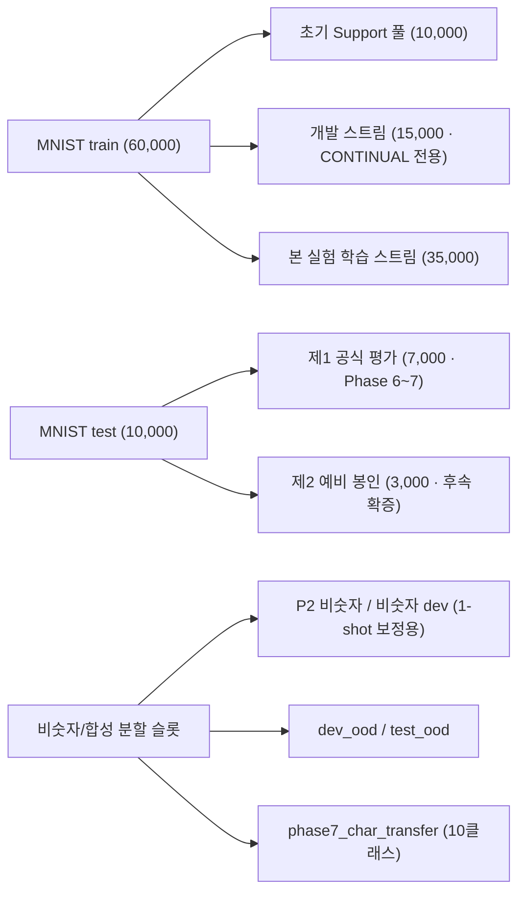

# FoveaCore Phase 0 세부 구현 명세서 (`phase0_detail_plan.md`)

- **상위 기준 문서:** `FoveaCore 연구·구현 계획서 v1.9.3 (GPU 기준 개정본)`
- **대상 단계:** Phase 0 — 프로젝트 상태 복구, 실험 환경, 데이터 격리 및 초경량 기준
- **단계 핵심 목적:** 단순한 개발 환경 구축을 넘어 **실험의 공정성·재현성·독립성을 코드와 테스트로 강제**하는 GPU 실험실 인프라 완성
- **개발 스택 및 의존성 원칙:**
  - PyTorch(CUDA/GPU) 중심 + 데이터 처리·통계·`B0/B1`은 NumPy/`scikit-image` 활용
  - **Phase 0~7 기본 프로젝트**는 텍스트 모델·LLM 라이브러리 없이 **GPU 기반 환경**에서 독립 실행되어야 함
  - 설정은 `YAML`, 산출물은 `JSON`/`CSV`/`JSONL`, 검증은 `pytest`, 추적은 `artifacts/<run_id>/` + `STATE.md` + `Git`으로 고정

---

## 1. Phase 0 핵심 원칙 및 비범위 (Scope & Non-Goals)

### 1.1 반드시 지켜야 할 8대 원칙

| 중요도 | 항목 | 코드 수준의 강제 수단 |
|---|---|---|
| **최상** | 실험·사전학습·라벨 정책 결합 통제 | `ExperimentProtocol` × `PretrainingPolicy` × `ExecutionMode` × `split_name` 호환 매트릭스 검증, 모순 조합 및 `STRICT_1SHOT` 숫자 개발 보정 차단 |
| **최상** | 공식 평가 데이터 봉인 및 정답 분리 | Phase 컨텍스트 + `freeze_manifest.json` 다중 기준점 SHA-256 검증 기반 봉인(`Phase 0~5` 접근 불가), 분할 매니페스트와 정답 저장소(`ground_truth_vault.json`) 분리 |
| **최상** | 미래 데이터·라벨 접근 차단 | `INFER` 모드에서 `BlindSample`만 전달, `ADAPT`의 공식 평가/미확정 `query` 라벨 접근 금지, 스트림/에피소드 커서 선조회(`look-ahead`) 차단 |
| **최상** | 에피소드·모델 전체 상태 불변성 | `INFER` 전후 `parameters()` + `buffers()` + `memory.json` + 내부 상태 해시 일치 및 `eval()` 강제, 에피소드 간 초기 스냅샷 복원 |
| **상** | 초경량 자원 계측 | 총 파라미터 ≤ 1,000,000,000(1B; `Q`·`DAS` 포함, `data_ptr` 중복 제거) 및 FP32 ≤ 4 GB(4,000,000,000 bytes) 검증, `Peak VRAM`/`Peak RAM` 및 `B0/B1` 비파라미터 상태량 분리 기록 |
| **상** | 실험 재현성 및 수치 안정성 | 5종 시드 분리 + GPU 결정론·FP32/TF32 차단 강제 + 결정론적 출력과 환경 변동 계측치(시간/VRAM/RAM) 분리, `assert` 대신 `NumericalInstabilityError` 검출 |
| **상** | 비교군 공정성 | 동일 에피소드 JSON 제공, 동일 초기 스냅샷에서 독립 실행, `P3`/`REFERENCE_P3`의 `H1~H6` 판정 투입 차단 |
| **상** | 실험 추적 및 사전등록 | 부록 4·5 전체 필드(5종 시드 + GPU·CUDA·정밀도·결정론 설정·`Peak VRAM` + `git_dirty`·`source_tree_hash`·실패 원인) 기록, 통계 예외 처리·`H13-V` 별도 규칙·사전 등록 잠금 |

### 1.2 Phase 0에서 구현하지 않을 것 (비대해짐 방지)

다음 항목은 후속 Phase의 책임이며 Phase 0에서는 인터페이스 계약 외 **구현을 금지**합니다.
- Foveal Sensor (`F1~F4`) 및 합성 선·곡선·그래프 생성기 본체 (Phase 1)
- Saccade Controller 및 2층 GRU Temporal Aggregator (Phase 2)
- 구조·스타일 분리 인코더 및 2단계 DAS 학습·구축 알고리즘 (Phase 3)
- 조건부 World Model (`W`), 중복 감쇠 역추론 및 EIG 계산기 (Phase 4)
- 반례 생성기, `$L_{\text{adapt}}$`, `S0~S5` 스트림 적응 및 `quarantine.json` 샌드박스 엔진 (Phase 5)
- 텍스트 어댑터, 공통 의미 공간, LLM 인터페이스(A안) 및 NAT(B안) (Phase 8~13)
- 인터랙티브 웹 대시보드 UI (`Foveal Cognitive Lab`)

---

## 2. 구현 전 확정 기준 (Decision Lock-in)

### 2.0 공통 이미지 입력·전처리 규격 (Phase 1 센서용 계약 선확정)

- **원본 해상도 임의 수용:** 센서 입력은 `(H,W)`(`H,W≥1`)이며 원본을 정사각형으로 강제하거나 작은 이미지를 업스케일하지 않습니다. 센서 출력 격자만 프로파일별로 고정합니다. 기본 `5×5×4`(PyTorch `[B,4,5,5]`), Phase 7 검증 후 독립 스케일업 `97×97×4`(`[B,4,97,97]`)입니다. **MNIST B0/B1 및 공식 기본 28×28/56×56 입력 조건은 기존대로 유지**합니다.
- **긴 변 상한 `max_side=1024`:** `L=max(H,W)`. `L≤1024`이면 `(H',W')=(H,W)` 그대로 사용하며, `L>1024`이면 비율을 유지하여 `(H',W')=(max(1,round(H·1024/L)),max(1,round(W·1024/L)))`로 **축소만** 합니다(`AdaptiveAvgPool2d((H',W'))` 또는 동일 의미론의 면적 평균 축소). 예: `4096×3072→1024×768`, `3072×4096→768×1024`, `1920×1080→1024×576`.
- **좌표 일치:** 시선 좌표는 처리 캔버스 `(H',W')`의 픽셀 중심을 기준으로 `[0,1]` 정규화합니다(길이 1인 축의 중심은 `0.5`). 내부 `grid_sample(align_corners=False)` 좌표 변환, 기존 `[-1,1]`·픽셀 좌표 변환 및 반픽셀 보간 정책을 함께 테스트합니다.
- **Phase 1 출력 계약:** F3 기본은 **중심 5×5 원본 + 중간 11×11→5×5 Adaptive Max Pooling + 외곽 19×19→5×5 Masked Adaptive Average Pooling + 외곽 유효비율 5×5 마스크**의 4채널 출력입니다. 경계 밖은 `0`으로 채우되, 평균 계산의 분모에서 제외합니다. `adaptive_avg_pool2d`는 `count_include_pad=False` 인자를 받지 않으므로 **마스크 기반 평균**을 구현하고, 빈 영역은 `0`으로 처리합니다. 중심/중간/외곽 각각의 개별 유효 마스크는 별도 메타데이터에 보존합니다. F4(외곽 19→3)는 최근접 정렬로 공통 5×5 4채널을 유지하며 실제 3×3 정보량을 별도 기록합니다.
- **별도 고해상도 프로파일:** Phase 7 이후 `97×97` 원본 + `257×257→97×97` Max + `513×513→97×97` Masked Average + `97×97` 마스크로 확장합니다. 이는 새로운 센서·입력 투영·보폭·비용·체크포인트 프로파일이므로 **Phase 0~7의 사전등록된 비교 조건을 변경하지 않습니다.**
- **Phase 0 실행 범위:** 입력 정규화 설정·인터페이스·해시/메타데이터·단위 테스트 fixture만 확정하고, 실제 풀링 센서 구현은 Phase 1로 둡니다.

### 2.1 Seed 정책 (용도별 5종 시드 분리)
- `split_seed`: 데이터셋 분할(`MNIST train` 3분할, `MNIST test` 2분할, OOD/전이 분할) 고정용 마스터 시드
- `episode_seed`: `10-way 1-shot` Support/Query 에피소드 샘플링 전용 시드
- `generator_seed`: 합성 도형/반례/이동/가림 생성기 전용 시드
- `model_seed`: 모델 초기화 및 학습 셔플 전용 시드 (최소 3개 이상 독립 시드 관리)
- `stream_order_seed`: 지속 학습 경험 입력 순서 순열 전용 시드

### 2.2 동일 Seed 재현성 판정 범위 (결정론 vs 환경 변동 분리)

- **GPU 결정론 및 FP32 기준:** `CUBLAS_WORKSPACE_CONFIG=:4096:8`(CUDA 초기화 전 설정)과 `torch.use_deterministic_algorithms(True, warn_only=False)`, `cudnn.deterministic=True`, `cudnn.benchmark=False`를 강제합니다. 기본 프로젝트(Phase 0~7)는 **FP32**로 통일하며 `torch.set_float32_matmul_precision("highest")`, `matmul.allow_tf32 = False`, `cudnn.allow_tf32 = False`로 묵시적 TF32 연산을 차단합니다.
- **동일 환경 비교 원칙:** 동일 시드 재현성 검사는 **동일 GPU 기종(`gpu_name`)·CUDA 환경(`cuda_version`)·정밀도(`precision`)** 내에서 수행합니다.

| 항목 | 재현성 판정 기준 | 비고 |
|---|---|---|
| 데이터 분할 ID & 에피소드 ID | **완전 일치 (Exact match)** | Support/Query 구성 동일 |
| 예측 클래스 (`y_pred`) | **완전 일치 (Exact match)** | 동일 입력에 대한 argmax 동일 |
| 모델(파라미터+버퍼)·기억 상태 해시 | **동일 GPU·CUDA·정밀도 환경에서 해시 일치** | `checkpoint_hash`, `memory_hash` |
| 부동소수점 수치 (거리·확률·정확도) | **사전 정의 허용 오차 이내** (`atol=1e-6, rtol=1e-5`) | GPU 결정론 + FP32(TF32 비활성화) 활성 시 |
| 실행 시간(`latency`)·`Peak VRAM`·`Peak RAM` | **반복 측정 및 분포 비교** | `torch.cuda.synchronize()` + 워밍업 적용, 일치 판정 제외 |
| `run_id`·타임스탬프 | **일치 대상 제외** | 매 실행 고유 발급 |

### 2.3 B0/B1 거리 함수, 수치 경계 조건 및 HOG 구현체 확정
- **MNIST 확보 방식:** 최초 1회 다운로드 또는 기존 로컬 캐시를 사용하되, 원천 파일 **SHA-256 체크섬 검증 후 `data/raw/`에 로컬 고정**.
- **입력 경계 조건 검증:**
  - shape `(28, 28)` (또는 `(1, 28, 28)` 정규화), 모든 원소 `np.isfinite()` 충족, 값 범위 검증(`uint8 [0, 255]` → `[0.0, 1.0] float32`, 이미 float인 경우 `[0.0, 1.0]` 범위 확인; 범위 이탈 시 `ValueError`).
  - `STRICT_1SHOT` 지원 집합은 정확히 클래스 `0~9` 각 1장(총 10장)임을 검증.
- **B0 (`Pixel 1-NN`):** 784차원 평탄화 벡터를 L2 정규화 후 유클리드 거리($\|\hat{x}_q - \hat{x}_s\|_2$) 계산.
  - **영벡터 경계 처리:** `norm < 1e-12`인 영벡터는 나눗셈(`0/0 -> NaN`)을 금지하고, 둘 다 영벡터면 거리 `0.0`, 한쪽만 영벡터면 단위구 최대 유클리드 거리 `2.0`을 반환.
- **B1 (`HOG + 1-NN`):** 단일 구현체로 **`scikit-image` (`skimage.feature.hog`)**를 확정하고 `locks/phase0_requirements.lock`에 버전을 고정.
  - 고정 파라미터: `orientations=9`, `pixels_per_cell=(4, 4)`, `cells_per_block=(2, 2)`, `block_norm="L2-Hys"`, `feature_vector=True`
  - 추출 벡터 `np.isfinite()` 검증 + 동일 영벡터(`norm < 1e-12`) 경계 처리 적용 후 유클리드 거리 계산.
- **동점(Tie-breaking) 규칙:** `abs(d1 - d2) <= 1e-12` 시 **클래스 ID 오름차순(`0 < 1 < ... < 9`)** 선택 및 동점 발생 횟수 로깅.

### 2.4 자원 계측 범위, 중복 방지, FLOPs 및 잠정 목표치
1. **파라미터 계측 (`≤ 1,000,000,000` / 1B 상한):**
   - `total_params == active_params + frozen_params` 항등식 검증
   - **이중 집계 방지:** `id(tensor)`와 함께 **`(tensor.data_ptr(), tuple(tensor.shape), tuple(tensor.stride()))` 복합 키**를 사용해 동일 파라미터 객체 및 weight-tied/view 공유 텐서 중복 집계 원천 차단
   - **독립/학습 파라미터 누락 방지:** 동결 `target_encoder_Q` 파라미터, `DAS` 학습 파라미터($\Delta\mu_c, w_c$)를 명시적 슬롯으로 합산 검증
   - **비파라미터 상태 저장량:** `B0/B1` 등 파라미터 없는 기준선은 `non_param_state_bytes`(support 배열·인덱스 메모리)를 별도 기록
2. **저장 용량 4종 & 실행 메모리 (`VRAM` / `RAM`):**
   - `weight_size_fp32` (`≤ 4 GB`, 1B FP32 기준 `4,000,000,000 bytes`), `memory_size` (`memory.json`), `quarantine_size` (`quarantine.json` 별도), `checkpoint_size` (`checkpoint.pt`)
   - `peak_vram`: CUDA 실행 전 `torch.cuda.reset_peak_memory_stats()` 초기화 후 추론(`infer`)과 적응(`adapt`) 구간별 `max_memory_allocated()` / `max_memory_reserved()`를 분리 측정
   - `peak_ram`: 독립 서브프로세스에서 단일 작업 실행 후 OS 프로세스 `RSS Peak`(`resource.getrusage` / `psutil`) 및 작업 순증가량(`delta`) 측정, `tracemalloc` 힙 피크 병기
3. **연산량 & 계측 모드 분리:**
   - 환산 기준: **`1 MAC = 2 FLOPs`**
   - 추론 FLOPs에는 순전파 + 행동 선택/MC 롤아웃 평가 비용 합산 및 `unsupported_ops` 목록 기록
   - GPU 시간은 비동기 실행 완료를 위해 **`torch.cuda.synchronize()`** 후 수치 확정하며, 측정 전·구간당 **최소 3회 워밍업** 후 계측
   - **`minimal` 모드**(지연시간 공식 계측, 훅 비활성)와 **`instrumentation` 모드**(상세 trace/FLOPs 훅 활성) 분리
   - `gpu_name`, `cuda_version`, `cudnn_version`, `precision`, `allow_tf32`, `CUBLAS_WORKSPACE_CONFIG`, `OMP_NUM_THREADS`, `MKL_NUM_THREADS`, `torch.get_num_threads()` 기록
4. **비용 예산 성격:** GPU 추론 지연(`latency`)·`Peak VRAM` 상한, 최대 32 update step 등은 **잠정 개발 목표(provisional dev target)**이며 공식 상한은 Dev 실측 후 Phase 6·7 통합 동결 전 확정.

### 2.5 데이터 중복 검사 및 Writer ID 미제공 정책
- **원본 ID 중복:** 즉시 차단 (`FAIL`)
- **완전 일치 이미지 SHA-256 해시 중복:** 즉시 차단 (`FAIL`)
- **지각 해시(pHash) 및 근접 유사도 중복:** 유사 후보(candidate) 리스트 검출 및 사전 정의 규칙(분할 경계 일치 여부·검토 로그) 처리
- **Writer ID 미제공 데이터(MNIST 등):** 공식 `train`/`test` 경계 준수 + 해시/근접 검사로 대체하되 **독립 필체 검증 한계 명시**. (`P2`/`OOD`/Phase 7 문자 전이 실험은 `writer_id`/`alphabet_id` 확보 여부 사전 검증)

### 2.6 통계적 판정 규칙 (`H1~H6, H12-V, H15-V` MECE + `H13-V` + 예외·가족군)

#### (A) 입력 유효성 검증 및 실험 무결성 우선 원칙
- **무결성 실패 (`TECHNICAL_FAIL → DEFERRED`):** 데이터 누출, 봉인 침해, 라벨 유출, 재현성 실패, `NumericalInstabilityError`, 공식 평가 시 `git_dirty` 등 무결성 오류 발생 시 연구 가설 판정을 `NOT SUPPORTED`로 내리지 않고 **`TECHNICAL_FAIL` 처리 후 연구 가설 판정 `DEFERRED`(보류)**.
- **통계 입력 예외 처리:** 표본 수 `n < 2`, `MDE <= 0`, `L > U`, `NaN`/`Inf` 포함 시 즉시 `InvalidStatisticsInputError` 또는 `TECHNICAL_FAIL` 반환(잘못된 `SUPPORTED`/`NOT SUPPORTED` 오분류 차단). `σ_paired == 0` 등 퇴화 분포(degenerate distribution)는 bootstrap 분산 0을 명시 로깅하고 검정력 계산 시 `ZeroVarianceWarning` 처리.
- **참고군(`REFERENCE_P3`) 배제:** `eligible_for_h1_h6 == False` 결과 입력 시 `H1~H6` 판정기 실행을 즉시 차단.

#### (B) 개선·비열등 효과 가설 (`H1~H6`, `H12-V`, `H15-V`) — MECE 4단계 분기
*(전제: `2.6(A)` 통과 후 평가, 모든 지표는 개선 방향이 양수 `MDE > 0`이 되도록 부호 정규화)*
- **Holm 다중비교 가족군(Family):** 기본 프로젝트 주 가설군 `{H4, H5}`에 대해 Holm-Bonferroni 보정 95% bootstrap CI `[L, U]` 적용(보조 가설 `H1, H2, H3, H6` 및 스트림 가설 `H12-V, H15-V`는 사전 등록 가족군별로 보정 CI와 비보정 CI 병기).
- **제약 연동:** `H15-V`는 `H13-V`의 망각 한도 충족을 필수 동반 제약으로 포함.
1. **1순위:** **모델 동반 제약**(망각 상한 $F_t \le F_{\max}$, 비용 상한, `H5` 모델 가설 셔플 테스트 미달 등) 위반 → **`NOT SUPPORTED`** *(데이터/라벨 누출은 2.6(A) 전담)*
2. **2순위:** 동반 제약 충족 & (`est <= 0` OR `U < MDE`) → **`NOT SUPPORTED`**
3. **3순위:** 동반 제약 충족 & (`L > 0` AND `est >= MDE`) → **`SUPPORTED`**
4. **4순위:** 나머지 모든 경우 (`est > 0` AND `U >= MDE`, 단 `L <= 0` 또는 `est < MDE`) → **`INCONCLUSIVE`** (`4a`: 검정력 부족 / `4b`: `0 < L <= est < MDE <= U`)

#### (C) 망각 한도 평가 가설 (`H13-V`) — 전용 상한 판정 규칙
*(전제: `2.6(A)` 통과 후 평가, `95% CI = [L_F, U_F]`)*
- **`SUPPORTED`:** `U_F <= F_max`
- **`NOT SUPPORTED`:** `L_F > F_max`
- **`INCONCLUSIVE`:** `L_F <= F_max < U_F`

---

## 3. 세부 작업 명세 (`T0 ~ T8`)

### `T0` — 프로젝트 상태 복구, Git 기준점 및 의존성 잠금 확보 (최우선 선행)
- 기존 디렉토리 파일·패키지·Git 상태 점검 (`git status`) 및 Git 저장소 초기화/복구, `.gitignore` 설정, 초기 기준 커밋
- 오래된 editable 설치 정리 (`pip uninstall -y foveacore`)
- `pyproject.toml` 및 `src/foveacore/` 패키지 골격 생성 → `pip install -e .` → `import foveacore` 경로 검증
- `README.md` 기준 버전을 **`v1.9.3`**으로 수정, `STATE.md` 초기화
- **의존성 잠금 파일 생성:** `pip freeze > locks/phase0_requirements.lock`으로 현재 GPU/CUDA 환경 의존성 버전을 Git으로 추적·고정하고, `dependency_lock_hash`는 이 lock 파일의 SHA-256으로 산출

### `T1` — 패키지 골격, CLI 및 Git 추적 명확화 (`0.1`)
- `configs/phase0.yaml` 작성 및 스키마 유효성 검증기 구현 (`input.max_side=1024`, `input.resize_method=adaptive_average`, `sensor.grid_size=5`, `sensor.channels=4`, `sensor.profile=F3`는 **센서 계약 설정값**으로 선등록; 고해상도 `grid_size=97`는 별도 프로파일로 관리)
- `src/foveacore/__main__.py` CLI 진입점 구현 (`validate`, `build-splits`, `smoke-baseline`)
- `git_dirty` 판정 기준 명문화: `git status --porcelain` 기준으로 `src/`, `configs/`, `locks/`, `pyproject.toml` 내 수정·미추적(untracked) 파일 존재 시 `git_dirty = True`
- 금지 패키지(`transformers`, `openai`, `anthropic`, `llama_cpp`, `vllm`, `langchain` 등) 미설치/미임포트 검증 테스트

### `T2` — 설정·Seed·GPU 결정론·불변 공통 인터페이스 (`0.4`)
- `utils/seed.py`: 5종 시드 관리 + **GPU 결정론 및 FP32·TF32 차단 강제기**
  - CUDA 초기화 전 `CUBLAS_WORKSPACE_CONFIG=:4096:8` 설정 및 검증
  - `torch.use_deterministic_algorithms(True, warn_only=False)`, `cudnn.deterministic=True`, `cudnn.benchmark=False` 강제
  - `torch.set_float32_matmul_precision("highest")`, `matmul.allow_tf32=False`, `cudnn.allow_tf32=False` 강제
  - 비결정론 CUDA 연산(`grid_sample`·`scatter_add` 등 Phase 1~5 예정 연산 포함) 검출 테스트 훅 제공
- `utils/provenance.py`: OS/CPU/GPU(`gpu_name`)/CUDA(`cuda_version`)/cuDNN(`cudnn_version`)/PyTorch(`torch_version`)/정밀도(`precision`, `allow_tf32`)/결정론 설정/스레드/Git/패키지 수집
- `core/exceptions.py` (또는 `core/contracts.py`): 명시적 `NumericalInstabilityError` 정의(`assert`는 `python -O`에서 무시되므로 수치 검증에 사용 금지)
- `core/contracts.py`: 이미지 Observation provenance의 `original_hw`, `processed_hw`, `preprocess_profile_id`, `[0,1]` 좌표 및 `sensor_profile/grid_size`를 추가하고 기본/확장 격자 프로파일을 서로 호환 불가한 별개 버전으로 관리합니다.
- `core/contracts.py`: `v1.9.3` 부록 1의 6대 인터페이스(`Observation`, `Action`, `Structure`, `Hypothesis`, `Prediction`, `Memory`) 정의
  - **내부 데이터·Tensor·버퍼 불변성 보호:**
    - `dict` → `MappingProxyType`, `list` → `tuple`, `np.ndarray` → `setflags(write=False)`
    - `torch.Tensor`는 자체 write-protect 플래그가 없으므로 **생성·조회 시 `.detach().clone()` 방어 복사** + **내부 SHA-256/바이트 체크섬 스냅샷 기반 변경 탐지(`ImmutabilityViolationError`)** 적용
  - `schema_version = "1.0"`, JSON 왕복 직렬화 테스트

### `T3` — 데이터 분할(OOD·전이 포함)·동결 해시 기준점·정답 분리 (`0.2`)

- **OOD 및 문자 전이 데이터 분할 명세 포함:**
  - `split_manifest_v1.json` 스키마에 MNIST 5분할뿐만 아니라 **`p2_non_digit`**, **`non_digit_dev`**(엄격 1-shot 보정용), **`dev_ood`**, **`test_ood`**, **`phase7_char_transfer`**(10클래스) 분할 슬롯과 봉인 등급을 필수 등록.
  - `validator.py`에 `P2 ∩ dev_ood == ∅`, `P2 ∩ test_ood == ∅`, `P2 ∩ phase7_char_transfer == ∅`, `dev_ood ∩ test_ood == ∅`, `test_ood ∩ phase7_char_transfer == ∅` (클래스 및 writer/source 모두) 검증 규칙 구현. *(Phase 0에서는 매니페스트 스키마와 합성/비숫자 테스트 fixture로 검증기를 100% 테스트하며, 실제 EMNIST/Omniglot 등 외부 데이터 등록 시 동일 검증기를 적용)*
- **분할 매니페스트와 정답 저장소 분리 및 `ADAPT` 접근 범위:**
  - `split_manifest_v1.json`: 라벨 미포함(`sample_id`, `split_name`, `sha256`, `phash`, `sealed_level`).
  - `ground_truth_vault.json`: `sample_id → label` 격리 저장소.
  - `(ExecutionMode × split_name)` 접근 제어: `INFER` 전면 차단, `ADAPT`는 승인된 학습 분할(`support_pool`의 현재 에피소드 support, `CONTINUAL`의 승인된 `dev_stream`/`main_stream`)만 허용하며 **`official_test`, `reserved_sealed`, `test_ood` 및 미확정 `query_ids` 라벨 조회는 무조건 차단**.
- **`freeze_manifest.json` 해시 검증 기준점 정의 (`SealGuard`):**
  - 자기참조 해시 모순을 막기 위해:
    1. **정규화 해시 계산 규칙:** `freeze_manifest.json` 내 `manifest_sha256` 자체 필드를 제외한 나머지 본문을 **키 정렬·공백 제거된 Canonical JSON(`json.dumps(..., sort_keys=True, separators=(",", ":"))`)**으로 직렬화해 SHA-256 계산.
    2. **독립 기준점 대조:** 계산된 해시를 **외부 기준점(`freeze_manifest.sha256` sidecar 파일 및 Git 태그/커밋/사전등록 해시)**과 대조해 일치 여부 검증.
    3. **내부 아티팩트 교차 검증:** `freeze_manifest.json` 안에 기록된 `data_split_hash`, `config_hash`, `checkpoint_hash`가 실제 로드된 파일들의 실시간 SHA-256과 100% 일치하는지 검증 후에만 `Phase 6~7` 읽기 전용 봉인 해제.

### `T4` — 정책 결합 검증·전체 상태 불변성·에피소드 복원 & 커서 (`0.3`, `0.5`, `0.6`)
- **3대 축 + 결합 호환성 검증기 (`PolicyCompatibilityValidator`):**
  - `ExecutionMode`: `INFER`, `ADAPT`, `EVALUATE`
  - `ExperimentProtocol`: `STRICT_1SHOT`, `CONTINUAL`, `REFERENCE_P3`
  - `PretrainingPolicy`: `P0`, `P1`, `P2`, `P3`
  - **금지 조합 차단 예시:**
    - `(STRICT_1SHOT, P3)` → `PolicyConflictError` (엄격 1-shot에 숫자 사전학습 불가)
    - `(STRICT_1SHOT, ADAPT, dev_stream/main_stream)` → 차단 (10장 외 숫자 학습·보정 금지)
    - `(CONTINUAL/REFERENCE_P3)` 외 모드에서 `11`번째 실제 숫자 투입 → `OneShotBudgetExceededError`
    - `(P1, digit_template)` → `PretrainingLeakError`
    - `(REFERENCE_P3)` → `eligible_for_h1_h6 = False` 강제
- **모델 버퍼 및 전체 상태 불변성 검사 (`ReadOnlyInferenceGuard`):**
  - `INFER` 진입 시 `model.training == False` (`eval()`) 강제.
  - 추론 전후 **`parameters()` + `buffers()`(BatchNorm/등록 버퍼) + `memory.json` + 지정된 영속 내부 상태(`state_dict()` 전체)**의 SHA-256 스냅샷을 비교해 1비트라도 변경되면 `StateMutationError`.
  - `PredictionCommitLog`: `finalize()` 확정 전 `sample_id` 라벨 조회 차단.
- **에피소드 초기 상태 복원 & 미래 데이터 접근 차단:**
  - **초기 스냅샷 복원 (`restore_initial_snapshot()`):** 에피소드 시작 전 반드시 초기 상태 스냅샷(모델 파라미터·버퍼·기억)을 복원하고 `state_hash == initial_snapshot_hash`를 검증.
  - **미래 데이터 차단 커서 (`BoundedStreamCursor`):** 에피소드/스트림 데이터는 현재 인덱스 `t` 이하 항목만 반환하며 `t+k` 선조회(`peek`/직접 인덱싱) 시도 시 `FutureDataAccessError` 발생.
- **에피소드 생성기 및 Smoke 수량 통일:**
  - 10,000장 Support pool 전체 전달 차단, 에피소드당 정확히 10장(`0~9` 각 1장), `Support ∩ Query == ∅`.
  - **Smoke Test 수량 통일:**
    - `quick_smoke` (단위·CI 테스트): `1~3` 에피소드(또는 소형 비숫자 fixture)
    - `phase0_full_smoke` (Phase 0 완료 기준): 고정 `episode_seed`로 **`30` 에피소드** (`10-way 1-shot`, `n_query_per_class=20`, 에피소드당 200 Query) 생성·실행 (단, 무튜닝 배선 검증 전용).

- **센서 인수 조건:** T4의 `BlindSample`과 향후 Phase 1 센서만 전처리 이미지에 접근하는 역할을 분리합니다. T4 에피소드/스트림은 전처리 프로파일·시선 좌표 변환을 메타데이터에 기록하며 전체 처리 이미지를 모델 임베딩에 우회 전달하지 않습니다.

### `T5` — B0/B1 기준선 (`0.7`)
- `baselines/pixel_knn.py` (`B0`), `baselines/hog_knn.py` (`B1`, `scikit-image` 고정) 구현 (`2.3절` 경계 조건 반영).
- MNIST B0/B1 입력 `28×28`은 **기존 784차원 픽셀/HOG 기준선 그대로** 처리하며 새로운 4채널 센서 출력으로 대체하지 않습니다(비교군 공정성 유지).
- NumPy/`scikit-image` 기반 연산 수행 후에도 GPU 실행 환경 메타데이터(`compute_device`, `gpu_name`, `cuda_version`, `precision` 등)를 `manifest.json` 규격에 맞게 기록(`N/A` 또는 활성 환경 명시).
- `BlindSample` 입력 및 `ReadOnlyInferenceGuard` 연동, 동일 에피소드 JSON 파일 입력 처리, Accuracy·Confusion Matrix·동점 횟수 기록.

### `T6` — 초경량 GPU 자원 계측기 강화 (`0.8`)
- `evaluation/cost.py` 구현 및 검증용 더미 모형(공유 파라미터·뷰·버퍼·Q·DAS 포함) 단위 테스트:
  - `id()` + `(data_ptr, shape, stride)` 중복 제거, `total == active + frozen` 검증
  - `total <= 1,000,000,000 (1B)` & `weight_size_fp32 <= 4 GB (4,000,000,000 bytes)` 상한 검사
  - `B0/B1` 비파라미터 상태 저장량(`non_param_state_bytes`), `FLOPs`(`1 MAC = 2 FLOPs`) + `unsupported_ops`, GPU 동기화 지연(`torch.cuda.synchronize()` + 최소 3회 워밍업), `minimal` vs `instrumentation` 모드 기록
  - `peak_vram` (`reset_peak_memory_stats`, `max_memory_allocated`, `max_memory_reserved` — `infer`/`adapt` 분리) 및 서브프로세스 격리 `RSS Peak` + 순증가량 + `tracemalloc` 측정

- **향후 Phase 1/확장 계측 항목 계약:** 처리 전후 `(H,W)`, 센서 프로파일(`F1~F4`/확장), `grid_size`, 패치 크기, 4채널 전송량, 리사이즈·풀링 GPU 비용, 원본 접근 면적을 분리 기록하도록 필드 규격만 준비합니다.

### `T7` — Manifest·산출물 계약·5종 Seed·실패 복구 (`0.9`)
- **표준 산출물 디렉토리 (`artifacts/<run_id>/`, 부록 5 준수):**
  `manifest.json`, `config.yaml`, `metrics.csv`, `summary.json`, `traces/inference.jsonl`, `traces/learning.jsonl` (및 해당 시 `memory.json`, `checkpoint.pt`).
- **`manifest.json` 전체 필수 필드 계약 (`v1.9.3` 부록 4 + 5종 시드 + GPU/CUDA/정밀도/추적 완전 통합):**
  - **기본/버전:** `run_id`, `schema_version`, `run_status`(`"SUCCESS"` | `"FAILED"`), `failure_reason`, `config_hash`, `freeze_manifest_hash`, `data_split_hash`
  - **에피소드/데이터:** `episode_id`, `support_ids`, `query_ids`, `dataset_version`, `dataset_checksum`, `pretraining_source`, `experiment_protocol`, `pretraining_policy`
  - **재현성/시드/Git:** `seeds` (`split_seed`, `episode_seed`, `generator_seed`, `model_seed`, `stream_order_seed`), `deterministic_mode`, `code_commit`, `git_dirty`, `source_tree_hash`, `dependency_lock_hash`, `checkpoint_hash`
  - **GPU/CUDA/정밀도/결정론 환경:** `compute_device`, `gpu_name`, `cuda_version`, `cudnn_version`, `torch_version`, `precision`(`"fp32"` 등), `allow_tf32`, `deterministic_settings`(`use_deterministic_algorithms`, `cudnn_deterministic`, `cudnn_benchmark`, `cublas_workspace_config`)
  - **자원/비용:** `param_counts` (`total`, `active`, `frozen`, `target_encoder_Q`, `das_learnable`, `non_param_state_bytes`), `weight_size_fp32`, `memory_size`, `quarantine_size`, `checkpoint_size`, `peak_vram`, `peak_ram`
  - **실행 trace 요약:** `generated_sample_count`, `update_count`, `quarantined_count`, `inference_latency`, `sensor_policy`, `observation_history`
  - **이미지 전처리·센서 프로파일(이미지 런에 해당):** `original_hw`, `processed_hw`, `max_side`, `resize_method`, `preprocess_profile_id`, `sensor_profile`, `grid_size`, `sensor_window_sizes`, `sensor_pooling`, `sensor_mask_semantics` (센서 미구현 Phase 0 런은 `N/A` + 사유)
  *(미해당 항목은 `null` 또는 `"N/A (사유)"` 명시)*
- 공식 평가(`Phase 6~7`) 모드에서 `git_dirty == True` 시 실행 차단 훅, 원자적 저장(`atomic write`).
- **실패 복구 테스트 7종:** 손상 데이터, 잘못된 YAML, 중복 Support, 봉인 데이터/`ADAPT` 평가 라벨 접근, `INFER` 중 파라미터·버퍼·Tensor·메모리 변경, 산출물 저장 I/O 예외, **`NaN`/`Inf` 주입 시 `NumericalInstabilityError` 발생(`python -O` 옵션 포함)** → 모두 `exit_code != 0` 및 `manifest.json` `run_status: "FAILED"`·`failure_reason` 기록.

### `T8` — 사전등록·Smoke Test(무보정)·통계 검증·최종 감사 (`0.10`)
- **`dev_stream` vs 비숫자 dev 분할 용도 엄격 분리:**
  - **엄격 1-shot (`STRICT_1SHOT`):** **숫자 개발 데이터(`dev_stream`)로 임계값·하이퍼파라미터 보정 절대 금지.** 오직 **비숫자(`non_digit_dev`) 또는 합성 dev 분할**만 보정에 사용.
  - **`dev_stream`:** Phase 5/6의 **지속 학습(`CONTINUAL`) 스트림 개발** 전용.
  - **Phase 0 Smoke Test:** `quick_smoke`(1~3 에피소드) 및 `phase0_full_smoke`(30 에피소드) 모두 **파이프라인 배선·해시·자원 계측 확인 전용**이며 수치 기반 모델 개선·보정을 수행하지 않음. `phase0_full_smoke`는 항목 5의 **적응형 Stop 규칙**(최초 3회 의무 탐색 제거, 첫 관측 즉시 판정, t≥2부터 새 증거 반영)을 준수해 실행해야 함.
- `experiments/preregistration_v1.9.3.md` 확정 및 `evaluation/statistics.py` 단위 테스트(MECE 4단계, `H13-V`, `TECHNICAL_FAIL → DEFERRED`, `REFERENCE_P3` 차단, 입력 예외·`σ=0` 방어).

---

## 4. 권장 구현 일정 (`T0 ~ T8`, 목표 7일)

| 일정 | 작업 ID | 핵심 구현 및 검증 내용 | 커밋 단위 |
|---|---|---|---|
| **1일차** | `T0` + `T1` | 상태 복구, Git 기준점, `locks/phase0_requirements.lock`(GPU/CUDA 포함), editable 재설치, `README.md` `v1.9.3` 정합, `STATE.md`, CLI `validate`, `git_dirty` 기준, 금지 패키지 테스트 | `chore(phase0): restore repo, lock gpu env & base CLI` |
| **2일차** | `T2` | `phase0.yaml` 검증, 5종 Seed, GPU 결정론·FP32/TF32 차단, GPU/CUDA 환경 수집기, `NumericalInstabilityError` + 6대 불변 인터페이스 | `feat(phase0): contracts, 5-seeds, gpu determinism & provenance` |
| **3일차** | `T3` | MNIST 체크섬/로컬 고정, OOD·문자전이 포함 분할 매니페스트, `GroundTruthVault`(`ADAPT` 제한), `SealGuard`(동결 해시 기준점) | `feat(phase0): splits, ood/transfer schema & seal guard` |
| **4일차** | `T4` | 3축 정책 결합 검증기, `ReadOnlyInferenceGuard`(파라미터+버퍼+`eval()`), 초기 스냅샷 복원, 미래 차단 커서, 에피소드 샘플러 | `feat(phase0): policy matrix, state guards & sampler` |
| **5일차** | `T5` + `T6` | `B0`/`B1`(`scikit-image` + 영벡터/경계 검증), GPU 자원 계측기(`1B/4GB`·`data_ptr` 중복 제거·`peak_vram`·`cuda.synchronize` 워밍업·Q/DAS·비파라미터) | `feat(phase0): baselines B0/B1 & gpu resource profiler` |
| **6일차** | `T7` | 부록 4·5 전체 `manifest.json` + 5종 시드 + GPU/CUDA/정밀도/결정론/`peak_vram`, 원자적 저장, 실패 복구 테스트 7종 | `feat(phase0): full gpu manifest schema & failure recovery` |
| **7일차** | `T8` | `preregistration_v1.9.3.md`, `statistics.py`(예외·Holm·`H13-V`·`DEFERRED`), `phase0_full_smoke`(30 에피소드) & 게이트 감사 | `docs(phase0): preregistration, 30-ep smoke & gate audit` |

---

## 5. Phase 1 진입 게이트 (Exit Criteria)

아래 **10개 항목이 모두 `PASS`**이고 `STATE.md`에 검증 커맨드 및 로그가 기록되어야 Phase 1로 진입합니다.

1. **저장소·환경 무결성 (`T0/T1`):** `pip install -e .` 후 `import foveacore` 작동, GPU/CUDA 포함 `locks/phase0_requirements.lock` 추적, LLM/텍스트 라이브러리 미설치 확인, `README.md` `v1.9.3` 정합.
2. **데이터 격리·봉인·외부 분할 규칙 (`T3`):** 분할 간 ID·SHA-256 중복 0건, OOD·Phase 7 전이 disjoint 규칙 검증기 동작, `freeze_manifest.json` canonical 해시 + 독립 기준점 + 내부 교차 해시 검증, `Phase 0~5` 봉인 차단 확인.
3. **정책 결합 & 미래 차단 (`T4`):** `PolicyCompatibilityValidator` 모순 조합(`(STRICT_1SHOT, P3)` 등) 차단, `STRICT_1SHOT` 11번째 숫자 차단 및 숫자 dev 보정 차단, 에피소드 초기 스냅샷 복원, 미래 데이터 선조회 차단 검증.
4. **전체 상태 불변·라벨 권한 (`T2/T4`):** `INFER` 중 `parameters()`·`buffers()`·`memory`·`eval()` 및 `torch.Tensor` 방어 복사/변이 차단, `ADAPT`의 공식 평가/미확정 query 라벨 조회 차단, 확정 전 라벨 차단 통과.
5. **GPU 결정론·분리된 재현성 검증 (`T2/T5`):** `CUBLAS_WORKSPACE_CONFIG=:4096:8`, `deterministic_algorithms`, FP32(TF32 차단) 활성 및 동일 `gpu_name`·`cuda_version`·`precision` 환경에서 동일 시드 2회 실행 시 에피소드 ID·예측 클래스 완전 일치, 부동소수점 지표 `atol=1e-6` 이내 일치, `torch.cuda.synchronize()` + 워밍업 지연/`Peak VRAM`/`Peak RAM` 분포 기록 확인. **또한 적응형 Stop 규칙**(최초 3회 의무 탐색 제거, 첫 관측에서 b₁ 생성 후 즉시 판정, 계속 탐색 시에만 t≥2부터 새 증거 반영, 종료 조건: 판정 근거 충분 / 관측 소진 / 기대 이득 ≤ 비용)을 준수하는지 확인.
6. **B0/B1 Smoke Test (`T5/T8`):** `quick_smoke`(1~3 에피소드) 및 `phase0_full_smoke`(고정 시드 **`30` 에피소드**, **`10-way 1-shot`**, `n_query_per_class=20`)에서 `B0` 및 `B1`(`scikit-image`)이 보정/튜닝 없이 정상 실행·경계 조건(`NaN` 0건) 통과.
7. **GPU 자원 계측 정확성 (`T6`):** 검증용 더미 모델(공유 파라미터·뷰·버퍼·Q·DAS 포함)에서 `data_ptr` 중복 제거 후 `total == active + frozen` 오차 0, `≤ 1B` & `≤ 4 GB (4,000,000,000 bytes)` 검사, `peak_vram`·`peak_ram`, `B0/B1` 비파라미터 상태량, `unsupported_ops`·계측 모드·스레드·CUDA 환경 기록 확인.
8. **Manifest·산출물·실패 복구 (`T7`):** 부록 4·5 전체 파일 및 필드(5종 시드 + `gpu_name`/`cuda_version`/`precision`/`deterministic_settings`/`peak_vram` 포함) 기록, `git_dirty` 차단 훅, 실패 복구 테스트 7종(`NumericalInstabilityError` 포함, `python -O`에서도 검출) 모두 `exit_code != 0` + `FAILED` 원인 기록 확인.
9. **통계 판정 및 예외 처리 (`T8`):** MECE 4단계, `H13-V`, `TECHNICAL_FAIL → DEFERRED`, `REFERENCE_P3` 배제, `n<2`·`σ=0`·`NaN`·`MDE<=0` 예외 처리 단위 테스트 전수 통과.
10. **사전등록 완료 (`T8`):** `experiments/preregistration_v1.9.3.md` 확정 및 `python -m foveacore validate --config configs/phase0.yaml` 최종 PASS.

**Phase 1 센서 인수용 추가 계약 테스트(Phase 0에서는 스키마/fixture만):** `28×28`·`56×56` 무변형, `640×480`·`800×1000` 무업스케일, `4096×3072`·`3072×4096`·`1920×1080`의 예상 결과 크기, 1픽셀 축, `(x,y)` 좌표 왕복, 채널 4개 및 유효비율 범위, 마스크 기반 평균의 빈 bin 처리, F4 3×3→5×5 정렬, 원본/전처리 해시·프로파일 기록. **실제 GPU 풀링/센서 본체의 PASS는 Phase 1 게이트**로 유지합니다.